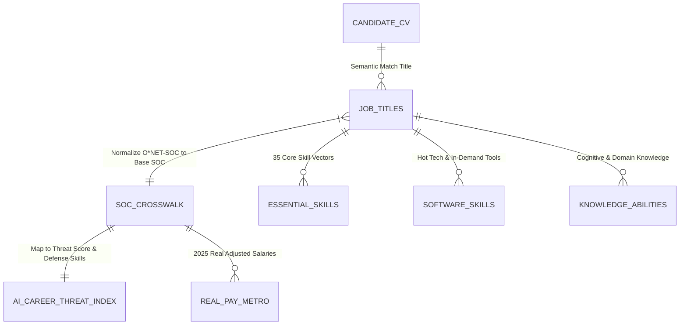
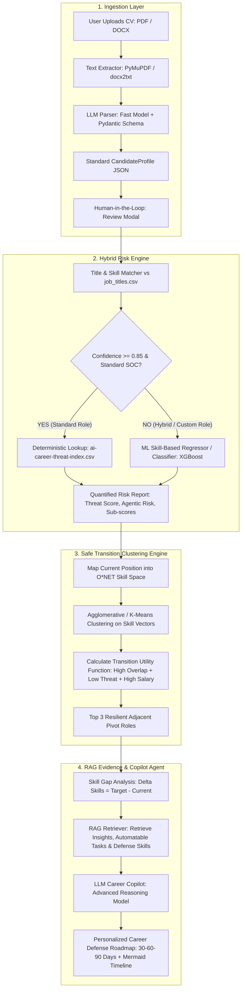

# Kế hoạch Triển khai: Nền tảng Thông minh AI Recruiter & Career Copilot

## 1. Goal Description (Mục tiêu Dự án)
Xây dựng nền tảng **AI Recruiter & Career Copilot** giải quyết triệt để vấn đề người lao động bị đe dọa bởi làn sóng AI/LLM Agent tự động hóa. Hệ thống kết hợp:
1. **Dữ liệu định lượng thực tế** về rủi ro AI (`ai-career-threat-index.csv`), bộ chuẩn kỹ năng/năng lực O*NET, và mức thu nhập thực tế 2025 (`voiced-real-pay-by-metro-2025.csv`).
2. **Kỹ thuật trích xuất thông minh từ CV** (LLM Parser + Pydantic Schema Validation + Human-in-the-Loop review).
3. **Mô hình Machine Learning (Clustering & Hybrid Risk Scoring Engine)**: Sử dụng cơ chế Hybrid Router phân luồng thông minh:
   - Tra cứu trực tiếp (Deterministic Lookup) cho các nghề đã chuẩn hóa.
   - Mô hình Machine Learning (XGBoost/LightGBM) dự báo rủi ro cho các vị trí lai (Hybrid roles).
   - Thuật toán Phân cụm không gian kỹ năng (Skill-space Clustering) tìm kiếm lộ trình chuyển dịch nghề an toàn (Safe Career Transition).
4. **RAG Evidence-Grounding Engine & LLM Career Copilot Agent** để đối chiếu khoảng cách kỹ năng (Skill Gap), trích xuất 3 kỹ năng phòng thủ AI (`defense_skills`) và sinh lộ trình học tập, chuyển đổi cá nhân hóa theo mốc 30 - 60 - 90 ngày.

---

## 2. User Review Required (Các Quyết định Cần Người Dùng Duyệt)

> [!IMPORTANT]
> **1. Lựa chọn LLM Model & Provider**:
> - Đề xuất: Phân tầng 2 cấp để tối ưu chi phí và tốc độ:
>   - **Tầng 1 (Trích xuất CV)**: Dùng Small/Fast Model (`Gemini 1.5 Flash` hoặc `GPT-4o-mini`) với chi phí cực thấp (~0.0001$/CV), phản hồi < 2s.
>   - **Tầng 2 (Copilot Reasoning & Lộ trình)**: Dùng Advanced Model (`Gemini 1.5 Pro`, `GPT-4o` hoặc `Claude 3.5 Sonnet`) để có văn phong cố vấn sắc sảo, logic và đồng cảm.
> - Người dùng cần xác nhận API Key sẽ sử dụng (Google Gemini API hay OpenAI API).

> [!NOTE]
> **2. Phạm vi Dữ liệu Lương (Salary Benchmarking)**:
> File `voiced-real-pay-by-metro-2025.csv` hiện chứa dữ liệu mức lương thực tế năm 2025 tại các vùng đô thị Hoa Kỳ (CBSA). Hệ thống sẽ hiển thị mức lương này dưới dạng chuẩn tham chiếu quốc tế (USD/năm) kèm cờ ghi chú, hoặc hỗ trợ hệ số quy đổi tương đương nếu người dùng yêu cầu thị trường nội địa.

---

## 3. Phân tích Dữ liệu Hiện có trong Thư mục `data/`

Thư mục `data/` sở hữu một hệ sinh thái dữ liệu chuẩn mực gồm **9 tệp CSV** liên kết chặt chẽ với nhau thông qua mã định danh chuẩn hóa quốc tế **O\*NET SOC Code**:

| Tên tệp | Kích thước | Số dòng | Khóa chính / Liên kết | Ý nghĩa & Vai trò trong Hệ thống |
| :--- | :--- | :--- | :--- | :--- |
| `ai-career-threat-index.csv` | 148 KB | 300 | `slug`, `soc_code` | **Lõi định lượng rủi ro AI**: Điểm đe dọa (`score` 4-92), `risk_level` (Low -> Very High), `agentic_risk`, phân rã rủi ro (`sub_task_automation`, `sub_tool_maturity`, `sub_adoption`, `sub_agentic_exposure`), xu hướng lương (`salary_trend`), và đặc biệt là 3 kỹ năng phòng thủ AI (`defense_skill_1, 2, 3`) kèm nhận định chuyên sâu (`insight`). |
| `soc-crosswalk.csv` | 76 KB | 867 | `soc_code` -> `nearest_role_slug` | **Cầu nối chuẩn hóa**: Ánh xạ 867 mã ngành chuẩn O*NET SOC sang 300 vai trò trong bảng AI threat index với mức độ khớp (`match_quality`: exact, close, general). |
| `job_titles.csv` | 4.5 MB | 54,269 | `O*NET-SOC Code`, `Job Title` | **Từ điển chức danh mở rộng**: Chứa hơn 54.000 tên gọi nghề nghiệp thực tế ngoài thị trường (ví dụ "Backend Developer", "Chief AI Officer") để map CV người dùng về mã SOC chuẩn. |
| `essential_skills.csv` | 2.3 MB | 18,200 | `O*NET-SOC Code`, `Element ID` | **35 Kỹ năng cốt lõi O*NET**: Đánh giá tầm quan trọng (`IM`) và cấp độ (`LV`) của Critical Thinking, Complex Problem Solving, Programming, Systems Analysis,... |
| `software_skills.csv` | 3.5 MB | 31,821 | `O*NET-SOC Code`, `Workplace Example` | **Bộ công cụ & Phần mềm**: Hơn 31.000 công nghệ/phần mềm thực tế (Python, Docker, React, AWS, Excel,...), kèm cờ công nghệ hot (`Hot Technology`) và nhu cầu thị trường (`In Demand`). |
| `knowledge.csv` | 8.0 MB | 60,060 | `O*NET-SOC Code`, `Element ID` | **33 Miền tri thức**: Đánh giá chuyên môn (Computers and Electronics, Mathematics, Administration & Management,...). |
| `abilities.csv` | 12.6 MB | 94,640 | `O*NET-SOC Code`, `Element ID` | **52 Năng lực nhận thức & thể chất**: Deductive Reasoning, Inductive Reasoning, Oral Expression,... |
| `task_ratings.csv` | 39.0 MB | 165,782 | `O*NET-SOC Code`, `Task ID` | **Nhiệm vụ chi tiết của từng nghề**: Tần suất (`FT`), mức độ quan trọng (`IM`) và tính phù hợp (`RT`) của hàng chục nghìn đầu việc cụ thể. |
| `voiced-real-pay-by-metro-2025.csv` | 8.3 MB | 47,380 | `soc_code`, `cbsa`, `area_name` | **Dữ liệu phân bố lương thực tế 2025**: Các phân vị thu nhập `p25, p50, p75` và lương thực tế đã điều chỉnh theo sức mua địa phương (`real_p25, real_p50, real_p75`, `rpp_all_items`). |

### Sơ đồ Liên kết Thực thể Dữ liệu (ER Flow)



---

## 4. Nhận xét & Đề xuất về Định dạng Đầu vào của CV

### 4.1. So sánh các định dạng đầu vào

| Định dạng | Trải nghiệm Người dùng (UX) | Độ phức tạp Xử lý (Parsing Complexity) | Nguy cơ Mất thông tin (Information Loss) | Độ tin cậy cho LLM |
| :--- | :--- | :--- | :--- | :--- |
| **PDF (Unstructured / Visual)** | **Rất cao** (95% người dùng có sẵn CV PDF). | Trung bình - Cao (Bố cục 2 cột, bảng, icon). | Trung bình (cần bảo toàn thứ tự đọc). | Cao nếu có tiền xử lý chuẩn. |
| **DOCX (Word Document)** | Cao (Dễ chỉnh sửa). | Thấp - Trung bình (`docx2txt` / `python-docx`). | Thấp. | Rất cao. |
| **Plain Text / Markdown** | Thấp (Bắt người dùng copy-paste thủ công). | Cực thấp (Đưa thẳng vào prompt). | Cao (Mất bố cục phân cấp). | Trung bình. |
| **Structured Form (Web Form)** | Rất thấp (Người dùng ngại điền form 30 ô). | Không có (Dữ liệu đã sạch sẵn). | Không có. | Cực cao. |

### 4.2. Khuyến nghị Giải pháp: "Hybrid Ingestion với Human-in-the-Loop"
1. **Frontend**: Tiếp nhận file **PDF và DOCX**.
2. **Text Extractor**: Dùng `PyMuPDF (fitz)` phân tách theo khối văn bản (text blocks) để không bị đảo dòng giữa 2 cột.
3. **Structured Parser**: LLM tầng 1 ép kiểu sang Pydantic `CandidateProfile`.
4. **Human-in-the-loop**: Pop-up xem lại hồ sơ trong 3 giây để người dùng kiểm chứng chức danh và danh sách kỹ năng, triệt tiêu ảo giác ngay tại nguồn.

---

## 5. Hướng đi và Hướng thực hiện Chi tiết cho Giải pháp Tinh chỉnh (Refined Solution Blueprint)

Phần này trả lời trực tiếp câu hỏi: **"Hướng đi và hướng thực hiện cụ thể cho giải pháp tránh Over-Engineering là gì?"**

### 5.1. Triết lý Thiết kế: "Kiến trúc Tam giác Cân bằng" (Balanced Triad Architecture)
Hệ thống không phó mặc tất cả cho LLM và cũng không lạm dụng ML ở những chỗ dữ liệu đã có sẵn quy tắc rõ ràng. Ba trụ cột gồm:
1. **Deterministic Router (Quy tắc & Tra cứu Chuẩn)**: Xử lý 80% trường hợp chuẩn hóa với độ trễ 0ms và độ chính xác 100%.
2. **Machine Learning Core (Clustering & Regressor/Classifier)**: Phân cụm chuyển đổi an toàn và tính điểm rủi ro cho các vai trò lai (hybrid roles).
3. **Agentic RAG Copilot (Bảo chứng Tri thức & Cố vấn Cá nhân hóa)**: Đưa ra dẫn chứng thực tế và sinh lộ trình thích ứng.



---

### 5.2. Hướng thực hiện Chi tiết Từng Trụ cột Kỹ thuật

#### Trụ cột 1: Xây dựng Bộ trích xuất & Hybrid Router (CV Parsing & Title Normalization)
* **Vấn đề**: Người dùng có thể viết "Senior MERN Stack Dev", "AI/ML Product Lead", hoặc "Trưởng phòng vận hành kiêm IT".
* **Hướng thực hiện**:
  1. Trích xuất text từ CV bằng `PyMuPDF` (giữ nguyên block layout).
  2. Dùng LLM nhẹ với prompt có cấu trúc trích xuất ra JSON:
     - `current_job_title`: Chức danh hiện tại.
     - `years_of_experience`: Số năm kinh nghiệm.
     - `hard_skills`: Danh sách kỹ năng cứng (ngôn ngữ, công nghệ, công cụ).
     - `soft_skills`: Kỹ năng mềm, quản lý.
     - `industry_domain`: Lĩnh vực hoạt động.
  3. **Module Title Normalization (`src/extraction/title_matcher.py`)**:
     - Sử dụng kết hợp **RapidFuzz Token Sort Ratio** và **Sentence-Transformers (all-MiniLM-L6-v2)** để so sánh `current_job_title` với 54.269 chức danh trong `job_titles.csv`.
     - Nếu điểm tương đồng $CosineSim \ge 0.85$: Lấy trực tiếp mã `O*NET-SOC Code` -> Ánh xạ qua `soc-crosswalk.csv` -> Lấy trực tiếp điểm rủi ro `score`, `risk_level`, `defense_skill_1, 2, 3` từ `ai-career-threat-index.csv`.
     - Nếu $CosineSim < 0.85$ (Vị trí lai hoặc chức danh tự do): Kích hoạt **Mô hình ML ở Trụ cột 2**.

#### Trụ cột 2: Mô hình Machine Learning: Phân cụm Chuyển dịch & Dự báo Vị trí Lai
* **Hướng đi cho bài toán Phân cụm (Safe Career Transition Clustering)**:
  - **Mục tiêu**: Không gom cụm ngẫu nhiên, mà tạo ra **Bản đồ Chuyển dịch Nghề nghiệp An toàn**.
  - **Không gian biểu diễn (Feature Space)**:
    - 35 chỉ số kỹ năng O*NET từ `essential_skills.csv` (chuẩn hóa $Importance \times Level \in [0, 1]$).
    - Multi-hot vector các công cụ thịnh hành từ `software_skills.csv` (`Hot Technology = Y`).
    - 33 chỉ số tri thức từ `knowledge.csv`.
    - Mức lương trung vị quốc gia năm 2025 (`voiced-real-pay-by-metro-2025.csv`).
  - **Thuật toán**:
    - Áp dụng `AgglomerativeClustering` (Hierarchical) hoặc `K-Means` với $K=12$ (tối ưu hóa theo Silhouette Score).
    - Khi ứng viên có nghề nghiệp hiện tại $C$, tìm các nghề mục tiêu $T$ theo **Hàm độ thỏa dụng chuyển dịch (Transition Utility Function)**:
      $$\text{Utility}(T) = w_1 \cdot \text{CosineSim}(\vec{S}_C, \vec{S}_T) + w_2 \cdot \left(1 - \frac{\text{ThreatScore}(T)}{100}\right) + w_3 \cdot \text{SalaryAdvantage}(T)$$
      *(với trọng số đề xuất $w_1 = 0.50$, $w_2 = 0.35$, $w_3 = 0.15$, và điều kiện ràng buộc $\text{ThreatScore}(T) < \text{ThreatScore}(C)$)*.
    - Kết quả: Hệ thống gợi ý **Top 3 Nghề nghiệp An toàn Lân cận (Adjacent Resilient Occupations)** mà người dùng chỉ cần học thêm ít kỹ năng nhất.

* **Hướng đi cho bài toán Dự báo Rủi ro Kỹ năng (Skill-Based Risk Scorer)**:
  - **Mục tiêu**: Dự báo `threat_score` (4-92) và `risk_level` cho các CV có chức danh hỗn hợp dựa trên **tổng hòa các kỹ năng người đó sở hữu**.
  - **Mô hình**: Huấn luyện một mô hình `XGBoostRegressor` và `XGBoostClassifier` trên ma trận kỹ năng của 300 nghề chuẩn O*NET.
  - Khi gặp chức danh lai: Vector hóa danh sách kỹ năng trên CV -> Đưa qua XGBoost -> Xuất ra điểm đe dọa ước lượng và xếp hạng rủi ro có độ tin cậy cao.

#### Trụ cột 3: Lớp RAG Engine Bảo chứng Tri thức (Evidence-Grounding Knowledge Base)
* **Vấn đề**: Tránh việc LLM bịa ra lời khuyên sáo rỗng ("hãy học hỏi thêm", "cần rèn luyện tư duy") hoặc giới thiệu các khóa học ảo.
* **Hướng thực hiện**:
  1. **Tạo Knowledge Vector Store**:
     - Chunking và Embedding các nội dung chất lượng cao:
       - Cột `insight` từ `ai-career-threat-index.csv` (phân tích tại sao AI thay thế nghề này).
       - Các tác vụ có rủi ro tự động hóa cao nhất từ `task_ratings.csv` (những tác vụ mà AI Agent sắp làm thay).
       - Bộ kỹ năng phòng thủ thực chiến (`defense_skill_1, 2, 3`) và danh sách phần mềm hot liên quan từ `software_skills.csv`.
       - Ngân hàng tài liệu/chứng chỉ chuẩn quốc tế (AWS, Google Cloud, Coursera, Scrum Alliance, AI Agent Architectures).
     - Lưu trữ trong thư viện vector nhẹ tại chỗ: `FAISS` hoặc `ChromaDB`.
  2. **Retrieval**:
     - Khi đã xác định được khoảng cách kỹ năng (Skill Gap = Kỹ năng cần có của nghề an toàn - Kỹ năng hiện tại của ứng viên), RAG sẽ truy xuất chính xác các tài liệu giải thích và bài học tương ứng với Skill Gap đó.

#### Trụ cột 4: LLM Career Copilot & Bộ sinh Lộ trình Cá nhân hóa (Dynamic Roadmap)
* **Hướng đi**: Sử dụng Advanced Reasoning LLM với System Prompt được thiết kế theo cấu trúc Senior Career Strategist & Tech Advisor.
* **Input Context đưa vào Prompt**:
  - Thông tin ứng viên (Kinh nghiệm, kỹ năng hiện có).
  - Điểm số rủi ro AI định lượng & phân rã các tác vụ bị đe dọa.
  - Top nghề chuyển đổi an toàn đã tính toán từ ML.
  - Skill Gap cụ thể (Những kỹ năng thiếu hụt trọng yếu).
  - Các đoạn dẫn chứng (Grounding chunks) từ RAG.
* **Đầu ra (Output Delivery)**:
  1. **Executive Assessment**: Đánh giá thực trạng khách quan, chỉ rõ tác vụ nào trong công việc hàng ngày của ứng viên sắp bị LLM Agent tự động hóa.
  2. **Strategic Pivot Options**: Bảng so sánh 2-3 hướng dịch chuyển nghề nghiệp (về độ an toàn AI, độ khó chuyển đổi và mức lương kỳ vọng 2025).
  3. **Personalized Defense Action Plan (30 - 60 - 90 Days)**:
     - **Tháng 1 (Foundation & AI Copilot Adoption)**: Làm chủ các công cụ AI trợ lực trong chính công việc hiện tại để không bị tụt lại.
     - **Tháng 2 (Core Reskilling & Defense Skills)**: Học chuyên sâu các kỹ năng phòng thủ then chốt (`defense_skills`).
     - **Tháng 3 (Portfolio Capstone & Transition)**: Xây dựng dự án thực chiến chứng minh năng lực kết hợp tác tử AI, chuẩn bị CV chuyển dịch.
  4. **Trực quan hóa Sơ đồ Lộ trình**: Xuất ra đoạn mã biểu đồ Mermaid (Gantt chart / Flowchart) hiển thị trực tiếp trên giao diện người dùng.

---

## 6. Proposed Changes (Thiết kế Cấu trúc Mã nguồn Dự án)

Toàn bộ hệ thống sẽ được xây dựng theo kiến trúc module hóa sạch sẽ, tách bạch giữa tầng xử lý dữ liệu, lõi ML, RAG và Agent:

```
c:\Users\Hai Nam\full_project\Job_advisor\
├── data/                          # [EXISTING] 9 tệp dữ liệu CSV gốc
├── data_cleaned_scaled/           # [OUTPUT] Dữ liệu sau khi xử lý & vector đặc trưng
│   ├── soc_feature_matrix.parquet # Ma trận đặc trưng kỹ năng 867 mã SOC
│   └── soc_metadata.parquet       # Thông tin metadata nối sẵn (lương, rủi ro, insight)
├── src/                           # [NEW] Mã nguồn hệ sinh thái
│   ├── __init__.py
│   ├── config.py                  # Cấu hình đường dẫn, API Keys, trọng số
│   ├── data_pipeline/             # Module Tiền xử lý dữ liệu
│   │   ├── __init__.py
│   │   ├── preprocess_onet.py     # Nối 9 CSV, chuẩn hóa thang đo, tạo ma trận kỹ năng
│   │   └── build_feature_store.py # Xuất parquet tối ưu hiệu năng
│   ├── extraction/                # Module Trích xuất CV & Chuẩn hóa
│   │   ├── __init__.py
│   │   ├── cv_parser.py           # Đọc PDF/DOCX qua PyMuPDF & docx2txt
│   │   ├── llm_extractor.py       # Trích xuất JSON Pydantic từ text CV
│   │   └── title_matcher.py       # Semantic matching chức danh về O*NET SOC
│   ├── ml/                        # Lõi Machine Learning
│   │   ├── __init__.py
│   │   ├── career_clustering.py   # Phân cụm thị trường & thuật toán Transition Utility
│   │   └── hybrid_risk_model.py   # Mô hình XGBoost dự báo điểm rủi ro cho vị trí lai
│   ├── rag/                       # Module RAG Tri thức nghề nghiệp
│   │   ├── __init__.py
│   │   ├── rag_indexer.py         # Tạo vector embeddings từ Insights & Defense Skills
│   │   └── rag_retriever.py       # Truy xuất dẫn chứng cho Skill Gap
│   ├── agent/                     # Module Cố vấn & Sinh Lộ trình
│   │   ├── __init__.py
│   │   ├── skill_gap_analyzer.py  # So sánh delta skills & phân loại thế mạnh/rủi ro
│   │   └── career_copilot.py      # LLM Agent lý luận & sinh lộ trình 30-60-90 ngày
│   └── api/                       # API Backend (FastAPI)
│       ├── __init__.py
│       └── app.py                 # REST API phục vụ Frontend / CLI
└── tests/                         # [NEW] Bộ kiểm thử tự động
    ├── test_data_pipeline.py
    ├── test_title_matcher.py
    ├── test_clustering.py
    └── test_end_to_end.py
```

### Chi tiết các tệp cốt lõi sẽ triển khai:

#### Component 1: Data Engineering (`src/data_pipeline/`)
- `[NEW] preprocess_onet.py`:
  - Ghép nối `essential_skills.csv` (chuẩn hóa $IM \times LV / 35 \in [0, 1]$), `software_skills.csv` (lọc các công cụ `Hot Technology = 'Y'`), `knowledge.csv` và `abilities.csv`.
  - Nối `soc-crosswalk.csv` với `ai-career-threat-index.csv` theo `soc_code`.
  - Tính toán mức lương trung vị quốc gia từ `voiced-real-pay-by-metro-2025.csv` (tính trung bình có trọng số theo quy mô việc làm `employment`).
  - Ghi kết quả vào `data_cleaned_scaled/soc_feature_matrix.parquet`.

#### Component 2: Ingestion & Router (`src/extraction/`)
- `[NEW] cv_parser.py`: Trích xuất text đa tầng từ PDF và DOCX.
- `[NEW] llm_extractor.py`: Sử dụng Pydantic Model xác định cấu trúc dữ liệu ứng viên:
  ```python
  from pydantic import BaseModel, Field
  from typing import List, Optional

  class CandidateProfile(BaseModel):
      full_name: Optional[str] = None
      current_title: str = Field(description="Chức danh hiện tại gần nhất của ứng viên")
      years_of_experience: float = Field(default=1.0)
      hard_skills: List[str] = Field(description="Danh sách công nghệ, ngôn ngữ, công cụ phần mềm")
      soft_skills: List[str] = Field(description="Kỹ năng mềm, quản lý, giao tiếp")
      domain_knowledge: List[str] = Field(description="Lĩnh vực chuyên môn")
      career_aspiration: Optional[str] = Field(default=None, description="Mục tiêu nghề nghiệp mong muốn")
  ```
- `[NEW] title_matcher.py`: Thuật toán tìm kiếm chức danh nhanh bằng RapidFuzz + SBERT Cosine Similarity đối chiếu trên 54.269 chức danh của `job_titles.csv`.

#### Component 3: Machine Learning Engine (`src/ml/`)
- `[NEW] career_clustering.py`:
  - Huấn luyện `AgglomerativeClustering(n_clusters=12, metric='cosine', linkage='average')`.
  - Triển khai hàm tính toán chuyển dịch nghề nghiệp tối ưu theo Utility Function đã định nghĩa ở mục 5.2.
- `[NEW] hybrid_risk_model.py`:
  - Huấn luyện `XGBRegressor` dự đoán `score` (4-92) và `XGBClassifier` dự đoán `risk_level` (Low, Moderate, High, Very High) cho các trường hợp không tìm thấy chức danh chuẩn.

#### Component 4: RAG Engine & Knowledge Base (`src/rag/`)
- `[NEW] rag_indexer.py`: Đọc cột `insight`, `defense_skill_1, 2, 3` từ `ai-career-threat-index.csv` và các tác vụ nguy cơ cao từ `task_ratings.csv`, tạo vector embeddings và lưu trữ tại `data_cleaned_scaled/faiss_index/`.
- `[NEW] rag_retriever.py`: Cung cấp hàm `retrieve_defense_evidence(soc_code, missing_skills) -> List[Document]`.

#### Component 5: Career Copilot Agent (`src/agent/`)
- `[NEW] skill_gap_analyzer.py`: Tính toán hiệu số $\Delta = \text{Skills}_{Target} \setminus \text{Skills}_{Current}$.
- `[NEW] career_copilot.py`: Xây dựng luồng hội thoại và tạo báo cáo cố vấn chiến lược:
  - Phân tích rủi ro định lượng.
  - Đề xuất 3 hướng chuyển dịch an toàn.
  - Lộ trình 30-60-90 ngày chi tiết (đầy đủ đầu sách, chứng chỉ, dự án mẫu, cách ứng dụng AI làm đòn bẩy).
  - Khối mã biểu đồ Mermaid Gantt chart trực quan hóa lộ trình.

---

## 7. Verification Plan (Kế hoạch Kiểm tra & Đánh giá)

### 7.1. Automated Tests (Kiểm thử Tự động)
Chạy bộ kiểm thử tự động với `pytest`:
```bash
# 1. Kiểm tra tính toàn vẹn của dữ liệu sau tiền xử lý
pytest tests/test_data_pipeline.py -v

# 2. Kiểm tra độ chính xác của bộ đối sánh chức danh (Title Matcher)
pytest tests/test_title_matcher.py -v

# 3. Kiểm tra tính hội tụ và chất lượng của mô hình Phân cụm & Dự báo ML
pytest tests/test_clustering.py -v

# 4. Kiểm tra luồng chạy hoàn chỉnh End-to-End từ text CV đến kết quả Copilot
pytest tests/test_end_to_end.py -v
```

**Tiêu chuẩn nghiệm thu định lượng (Acceptance Benchmarks)**:
- Tỷ lệ ánh xạ thành công mã ngành SOC từ `job_titles.csv` sang `ai-career-threat-index.csv`: $\ge 98\%$.
- Silhouette Score của mô hình phân cụm không gian kỹ năng: $\ge 0.40$.
- Sai số tuyệt đối trung bình (MAE) của mô hình ML Risk Scorer trên tập test: $\le 5.0$ điểm (trên thang điểm 100).
- Thời gian phản hồi của bộ trích xuất CV: $\le 3.5$ giây.

### 7.2. Manual Verification (Kiểm thử Thủ công Thực tế)
1. **Kiểm thử Kịch bản 1 - Nghề có Rủi ro Tự động hóa Cao**:
   - Nhập CV mẫu: *"Junior QA Tester / Manual Tester, 2 năm kinh nghiệm, kỹ năng: Viết test case, Jira, Postman, kiểm thử giao diện"*.
   - Kết quả kỳ vọng: Hệ thống cảnh báo rủi ro **High** (Threat Score ~49-55), chỉ rõ việc LLM Agent đang tự sinh test suite và tự phục hồi mã kiểm thử; đề xuất 2 hướng dịch chuyển an toàn sang *QA Automation & Model Validation Engineer* hoặc *DevOps/Platform Support*; vạch lộ trình 3 tháng học Agentic Testing và AI Model Validation.
2. **Kiểm thử Kịch bản 2 - Nghề có Rủi ro Thấp / An toàn**:
   - Nhập CV mẫu: *"Senior Site Reliability Engineer / Cloud Architect, 6 năm kinh nghiệm, kỹ năng: Kubernetes, Multi-Cloud, Incident Command, Zero Trust"*.
   - Kết quả kỳ vọng: Hệ thống trả về rủi ro **Low** (Threat Score ~31), phân tích lý do công việc này an toàn là do đòi hỏi trách nhiệm pháp lý và xử lý sự cố bất định; khuyến nghị bổ sung kỹ năng *AIOps Supervision* để tối ưu năng suất.
3. **Kiểm thử Kịch bản 3 - Chức danh Vị trí Lai (Hybrid Role)**:
   - Nhập CV mẫu: *"Product Owner kiêm Data Analyst kiêm No-code Builder"*.
   - Kết quả kỳ vọng: Router nhận diện không có mã SOC đơn lẻ trực tiếp, chuyển luồng sang mô hình XGBoost để tính toán điểm rủi ro tổng hợp dựa trên ma trận kỹ năng; sinh lộ trình chuẩn xác.
