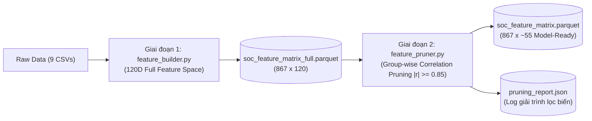

# Tiền Xử Lý Dữ Liệu & Thiết Kế Feature Store 120D
## Data Preprocessing, Normalization & Parquet Feature Store Architecture

Tài liệu này đặc tả toàn bộ quy trình tiền xử lý toán học, chuẩn hóa thang đo năng lực O\*NET, và thiết kế chi tiết ma trận đặc trưng **120 chiều (120-Dimensional Feature Matrix)** cùng bảng tra cứu danh mục **Metadata Store**.

---

## 1. Quy Trình Chuẩn Hóa Mã Ngành (SOC Code Harmonization)

### 1.1. Vấn Đề Lệch Định Dạng Giữa Các Tệp Dữ Liệu
* Các bảng khảo sát O\*NET (`essential_skills`, `knowledge`, `abilities`, `software_skills`, `task_ratings`, `job_titles`) dùng **mã 8 chữ số** (ví dụ: `15-1252.00` - Software Developers, `11-1011.03` - Chief Sustainability Officers).
* Bảng ánh xạ `soc-crosswalk.csv`, bảng rủi ro `ai-career-threat-index.csv` và bảng lương `voiced-real-pay-by-metro-2025.csv` dùng **mã 6 chữ số** (ví dụ: `15-1252`, `11-1011`).

### 1.2. Chiến Lược Gộp Chuẩn (Base SOC Aggregation)
1. **Trích xuất Base SOC**: Với mọi mã 8 chữ số, tách chuỗi tại dấu chấm `code.split('.')[0]` để lấy mã 6 ký tự `xx-xxxx`.
2. **Gộp trung bình có trọng số (Groupby Mean Aggregation)**:
   - Một mã 6 chữ số có thể có từ 1 đến 5 nhánh con chuyên sâu (ví dụ `11-3031.00`, `11-3031.01`, `11-3031.03`).
   - Ta thực hiện gom nhóm theo Base SOC và tính giá trị trung bình (`mean`) của các điểm năng lực $E$. Điều này giúp vector đặc trưng đại diện toàn diện cho toàn bộ nhóm ngành nghề.
3. **Đối chiếu Khung Xương Chuẩn**: Lấy 867 mã SOC trong `soc-crosswalk.csv` làm danh sách định danh chuẩn (`index`) cho toàn bộ Feature Matrix và Metadata Store.

---

## 2. Công Thức Toán Học Chuẩn Hóa Thang Đo Năng Lực O\*NET

### 2.1. Chuẩn Hóa Chỉ Số Tầm Quan Trọng & Cấp Độ (IM & LV)
O\*NET đánh giá mỗi kỹ năng/tri thức/năng lực theo 2 thang đo:
* **Tầm quan trọng (Importance - $IM$)**: Đo từ $1.0$ đến $5.0$.
* **Cấp độ thành thạo (Level - $LV$)**: Đo từ $0.0$ đến $7.0$.

Để kết hợp hai yếu tố này thành một chỉ số năng lực đơn nhất phản ánh đúng thực tế (kỹ năng vừa quan trọng vừa đòi hỏi trình độ cao sẽ có điểm số vượt trội), ta áp dụng công thức chuẩn hóa kết hợp:

$$E = \frac{IM \times LV}{35.0} \quad \text{với } E \in [0.0, 1.0]$$

*Giá trị cực đại:* Khi $IM = 5.0$ và $LV = 7.0 \Rightarrow IM \times LV = 35.0 \Rightarrow E = 1.0$.

### 2.2. Xử Lý Giá Trị Khuyết Thiếu (Imputation Strategy)
* Nếu một mã nghề không được khảo sát một kỹ năng cụ thể trong bảng O\*NET, giá trị $E$ được gán mặc định bằng $0.0$ (thể hiện nghề đó không đòi hỏi kỹ năng này).
* Sau khi pivot bảng phẳng thành ma trận, áp dụng phép điền `fillna(0.0)`.

---

## 3. Kiến Trúc Chi Tiết Của Feature Matrix 120 Chiều (`soc_feature_matrix.parquet`)

Ma trận đặc trưng được lưu dưới định dạng **Apache Parquet**, nén `snappy`, gồm đúng **867 dòng** (867 mã O\*NET SOC) $\times$ **120 cột số thực `float32`**:

```
┌──────────────────────────────────────────────────────────────────────────────────┐
│                   CƠ CẤU 120 CHIỀU ĐẶC TRƯNG (FEATURE COMPOSITION)               │
├─────┬──────────────────────┬────────┬──────────────┬─────────────────────────────┤
│ STT │ Nhóm Đặc Trưng       │ Số Cột │ Thang Đo     │ Nguồn Tệp CSV Gốc           │
├─────┼──────────────────────┼────────┼──────────────┼─────────────────────────────┤
│ 1   │ Basic Skills         │ 10     │ [0.0, 1.0]   │ essential_skills.csv        │
│ 2   │ Knowledge Domains    │ 33     │ [0.0, 1.0]   │ knowledge.csv               │
│ 3   │ Abilities            │ 52     │ [0.0, 1.0]   │ abilities.csv               │
│ 4   │ Software Domains     │ 20     │ [0.0, 1.0]   │ software_skills.csv (134 cats)│
│ 5   │ Economic & Complexity│ 5      │ [0.0, 1.0]   │ metro pay & O*NET tasks     │
├─────┴──────────────────────┴────────┴──────────────┴─────────────────────────────┤
│ TỔNG CỘNG GIAI ĐOẠN 1:     │ 120    │ [0.0, 1.0]   │ soc_feature_matrix_full.parquet│
└──────────────────────────────────────────────────────────────────────────────────┘
```

### 3.1. Danh Mục 10 Basic Skills (Cột 0 - 9)
1. `skill_reading_comprehension` (Đọc hiểu văn bản chuyên môn)
2. `skill_active_listening` (Lắng nghe tích cực)
3. `skill_writing` (Kỹ năng viết và truyền đạt văn bản)
4. `skill_speaking` (Kỹ năng diễn đạt nói)
5. `skill_mathematics` (Tư duy toán học & định lượng)
6. `skill_science` (Phương pháp luận khoa học)
7. `skill_critical_thinking` (Tư duy phản biện)
8. `skill_active_learning` (Học tập chủ động & thích ứng)
9. `skill_learning_strategies` (Chiến lược tiếp thu tri thức)
10. `skill_monitoring` (Giám sát và đánh giá hiệu năng)

### 3.2. Danh Mục 33 Knowledge Domains (Cột 10 - 42)
Bao gồm 33 miền tri thức từ `knowledge.csv`: *Administration & Management, Economics & Accounting, Sales & Marketing, Customer Service, Personnel & HR, Production & Processing, Food Production, Computers & Electronics, Engineering & Technology, Design, Building & Construction, Mechanical, Mathematics, Physics, Chemistry, Biology, Psychology, Sociology, Geography, Medicine & Dentistry, Therapy & Counseling, Education & Training, English Language, Foreign Language, Fine Arts, History & Archeology, Philosophy & Theology, Public Safety & Security, Law & Government, Telecommunications, Communications & Media, Transportation, Clerical*.

### 3.3. Danh Mục 52 Abilities (Cột 43 - 94)
Bao gồm 52 năng lực nhận thức và thể chất từ `abilities.csv`: *Oral Comprehension, Written Comprehension, Oral Expression, Written Expression, Fluency of Ideas, Originality, Problem Sensitivity, Deductive Reasoning, Inductive Reasoning, Information Ordering, Category Flexibility, Mathematical Reasoning, Number Facility, Memorization, Speed of Closure, Flexibility of Closure, Perceptual Speed, Spatial Orientation, Visualization, Selective Attention, Time Sharing, v.v.*

### 3.4. Danh Mục 20 Cụm Công Nghệ Nền Tảng (Software Taxonomy Domains - Cột 95 - 114)
20 Cụm Công Nghệ Nền Tảng gom từ 134 danh mục O*NET `Element Name`, tính theo tỷ lệ công cụ thuộc cụm $\in [0.0, 1.0]$:
1. `tech_cat_data_query_sql` (SQL, PostgreSQL, MongoDB, Oracle DB)
2. `tech_cat_development_env` (VS Code, Eclipse, PyCharm, Xcode)
3. `tech_cat_oop_programming` (Python, Java, C++, C#, Go, Rust)
4. `tech_cat_web_platform` (React, Node.js, Angular, Django, Spring)
5. `tech_cat_cloud_os_devops` (Linux, Docker, Kubernetes, AWS, Azure)
6. `tech_cat_analytics_scientific` (R, MATLAB, SAS, Pandas, TensorFlow)
7. `tech_cat_cad_engineering` (AutoCAD, SolidWorks, Revit, CATIA)
8. `tech_cat_enterprise_erp` (SAP, Oracle ERP, NetSuite)
9. `tech_cat_crm_sales` (Salesforce, HubSpot, MS Dynamics)
10. `tech_cat_bi_reporting` (Tableau, PowerBI, QlikView)
11. `tech_cat_multimedia_creative` (Photoshop, Illustrator, Premiere)
12. `tech_cat_security_network` (Wireshark, Splunk, Kali Linux, Nessus)
13. `tech_cat_project_management` (Jira, Trello, Asana, MS Project)
14. `tech_cat_document_management` (SharePoint, Adobe Acrobat, Confluence)
15. `tech_cat_gis_spatial` (ArcGIS, QGIS, Google Earth Pro)
16. `tech_cat_medical_clinical` (Epic Systems, Cerner, MEDITECH)
17. `tech_cat_accounting_finance` (QuickBooks, Sage, Bloomberg)
18. `tech_cat_office_spreadsheets` (Excel, Google Sheets, Calc)
19. `tech_cat_communication_collab` (Slack, Microsoft Teams, Zoom, Outlook)
20. `tech_cat_mobile_embedded` (Android SDK, iOS SDK, Flutter)

### 3.5. Danh Mục 5 Chỉ Số Kinh Tế & Độ Phức Tạp Công Việc (Cột 115 - 119 - Zero Leakage)
> [!IMPORTANT]
> **Tuyệt đối không đưa các biến Threat Score vào ma trận đặc trưng $X$** để chống rò rỉ nhãn (Label Leakage) cho XGBoost và bảo toàn khoảng cách kỹ năng khách quan cho Phân cụm. Toàn bộ thông tin rủi ro AI được lưu riêng tại `soc_metadata.parquet`.
> 
> 5 chỉ số khách quan gồm:
1. `econ_normalized_salary`: Lương trung vị thực tế 2025 sau khi bù khuyết, chuẩn hóa $[0.0, 1.0]$.
2. `complexity_data_level`: Mức độ phức tạp khi xử lý dữ liệu và thông tin theo O\*NET, chuẩn hóa $[0.0, 1.0]$.
3. `complexity_people_level`: Mức độ phức tạp trong giao tiếp và tương tác con người theo O\*NET, chuẩn hóa $[0.0, 1.0]$.
4. `complexity_things_level`: Mức độ phức tạp khi thao tác với máy móc và công cụ vật lý, chuẩn hóa $[0.0, 1.0]$.
5. `skill_breadth_index`: Độ rộng phổ công nghệ (tỷ lệ số lượng công cụ nghề đó sử dụng trên tổng kho), chuẩn hóa $[0.0, 1.0]$.

---

### 3.6. Quy Trình Tinh Lọc 2 Giai Đoạn (Two-Stage Feature Pipeline) & Group-wise Pruning



* **Giai đoạn 1 (Feature Extraction / Full Store)**:
  - Bóc tách đầy đủ 120 chiều năng lực gốc, lưu tại `data/clean_data/soc_feature_matrix_full.parquet` để bảo toàn tài sản dữ liệu.
* **Giai đoạn 2 (Group-wise Correlation Pruning / Gold Store)**:
  - Thay vì lọc toàn cục làm mất cân bằng các nhóm (nhóm 52 Abilities nuốt chửng nhóm 10 Skills), thuật toán tính **Ma trận tương quan Pearson riêng cho từng nhóm**:
    - `Skills` ($10 \rightarrow 5$ biến)
    - `Knowledge` ($33 \rightarrow 32$ biến)
    - `Abilities` ($52 \rightarrow 29$ biến, loại sạch 23 biến thể lực đa cộng tuyến)
    - `Software Domains` ($20 \rightarrow 18$ biến)
  - **Bước Tie-Break liên nhóm**: Quét 3 cặp biến liên nhóm trùng $> 0.95$ (như Mathematics skill vs Mathematical Reasoning ability) để giữ 1 biến có phương sai lớn hơn.
  - **Kết quả đầu ra**: Lưu ma trận sạch `soc_feature_matrix.parquet` (~55 chiều tối ưu, 100% không đa cộng tuyến) và báo cáo `pruning_report.json`.

---

## 4. Cấu Trúc Metadata Store (`soc_metadata.parquet`)

Metadata Store lưu trữ toàn bộ thông tin tra cứu phi số học để phục vụ tra cứu độ trễ 0ms của Router (Module 7), bóc tách Skill Gap theo đại số tập hợp và trích xuất dẫn chứng cho RAG (Module 5):

| Trường Dữ Liệu | Kiểu Dữ Liệu | Mô Tả & Ví Dụ |
| :--- | :---: | :--- |
| `soc_code` | `str` | Khóa chính: `'15-1252'` |
| `soc_title` | `str` | Tên chính thức: `'Software Developers'` |
| `threat_score` | `float` | Điểm đe dọa: `68.5` |
| `risk_level` | `str` | Cấp độ rủi ro: `'High'` |
| `sub_task_automation` | `float` | Rủi ro tác vụ: `72.0` |
| `sub_tool_maturity` | `float` | Độ chín muồi công cụ: `85.0` |
| `sub_agentic_exposure` | `float` | Phơi nhiễm Agentic: `75.0` |
| `defense_skills` | `list[str]` | Top 3 kỹ năng phòng thủ: `['Architecture Design', 'Systems Thinking', 'Human Collaboration']` |
| `insight` | `str` | Đoạn nhận định chuyên sâu từ chuyên gia |
| `median_salary` | `float` | Lương trung vị toàn quốc (USD/năm): `132513.5` |
| `software_skills_catalog` | `list[dict]` | Toàn bộ công cụ của nghề kèm cờ Hot/InDemand: `[{'name': 'Python', 'hot_tech': True, 'in_demand': True, 'category': 'tech_cat_oop_programming'}]` phục vụ so sánh Skill Gap ($B \setminus A$). |
| `top_hot_technologies` | `list[str]` | Danh sách công cụ hot của nghề: `['Python', 'Docker', 'Git', 'AWS']` |
| `critical_tasks` | `list[dict]` | Danh sách các tác vụ có tầm quan trọng cao nhất trích xuất từ `task_ratings.csv` |

---

## 5. Quy Trình Trích Xuất Corpus Tri Thức Cho Hierarchical Aspect-Based RAG Engine

Từ `soc_metadata.parquet` và `task_ratings.csv`, module Data Pipeline sẽ xuất ra tệp tri thức cấu trúc hóa `data/clean_data/rag_corpus.json`. 

Thay vì gom 1 khối văn bản to tướng dễ gây pha loãng embedding và nhiễu ngữ nghĩa chéo ngành, hệ thống áp dụng **Kiến trúc RAG Đa Phân Tầng Theo Khía Cạnh**:
1. **Phân vùng dữ liệu (Domain Partitioning)**: Gán nhãn `major_group` theo 23 nhóm ngành lớn O\*NET (ví dụ `15` cho Máy tính & CNTT, `11` cho Quản lý, `13` cho Tài chính). Khi truy vấn, hệ thống sẽ lọc namespace trước (Pre-filtering) để triệt tiêu 100% nhiễu từ các ngành không liên quan.
2. **Xé nhỏ 3 Micro-Chunks theo khía cạnh nghiệp vụ (Aspect-Based Micro-Chunking)**: Mỗi nghề O\*NET được chia thành đúng 3 chunk nhỏ độc lập (150–200 tokens/chunk), tổng kho tri thức $\approx 867 \times 3 \approx 2,600$ chunks:

```json
[
  {
    "chunk_id": "soc_15-1252_threat",
    "soc_code": "15-1252",
    "major_group": "15",
    "role_title": "Software Developers",
    "aspect": "threat_mechanism",
    "threat_score": 68.5,
    "risk_level": "High",
    "sub_scores": {
      "task_automation": 72.0,
      "tool_maturity": 85.0,
      "agentic_exposure": 75.0
    },
    "content": "Cơ chế đe dọa AI đối với Software Developers (SOC 15-1252): Điểm rủi ro tổng thể 68.5 (High). Các hệ thống tác tử lập trình tự chủ (Devin, Claude Code, GitHub Copilot Workspace) và công cụ sinh mã đang tự động hóa các tác vụ viết mã thường nhật, tạo khung dự án và kiểm thử tự động, làm giảm nhu cầu nhân lực ở các tác vụ lập trình cơ bản."
  },
  {
    "chunk_id": "soc_15-1252_defense",
    "soc_code": "15-1252",
    "major_group": "15",
    "role_title": "Software Developers",
    "aspect": "defense_skills",
    "defense_skills": ["Architecture Design", "Systems Thinking", "Human Collaboration"],
    "content": "Bộ 3 kỹ năng phòng thủ thực chiến cho Software Developers (SOC 15-1252): 1. Architecture Design: Thiết kế kiến trúc hệ thống phân tán, tối ưu hóa độ trễ và khả năng chịu tải. 2. Systems Thinking: Tư duy hệ thống tổng thể, tích hợp bảo mật và luồng dữ liệu end-to-end. 3. Human Collaboration: Kỹ năng phối hợp nghiệp vụ với các bên liên quan và chuyển hóa yêu cầu bài toán kinh doanh thành giải pháp công nghệ."
  },
  {
    "chunk_id": "soc_15-1252_tasks_tools",
    "soc_code": "15-1252",
    "major_group": "15",
    "role_title": "Software Developers",
    "aspect": "tasks_and_tools",
    "hot_technologies": ["Python", "Docker", "Kubernetes", "AWS", "Git"],
    "critical_tasks": [
      "Modify existing software to correct errors or improve its performance.",
      "Analyze user needs and software requirements to determine feasibility of design."
    ],
    "content": "Tác vụ tự động hóa & Công cụ chuyển đổi của Software Developers (SOC 15-1252): Các tác vụ có nguy cơ tự động hóa cao nhất gồm viết mã chức năng lặp lại và debug cú pháp cơ bản. Các công cụ công nghệ bùng nổ nhu cầu (Hot Tech) cần làm chủ để chuyển dịch sang vai trò an toàn hơn bao gồm: Python, Docker, Kubernetes, AWS Cloud, và Git Version Control."
  }
]
```

Tệp này là nguyên liệu đầu vào trực tiếp cho **Module 5: RAG Evidence Grounding Engine** để xây dựng chỉ mục tìm kiếm kết hợp **Pre-filtering theo Major Group + Aspect-Targeted Hybrid Search (BM25 + FAISS)**.
