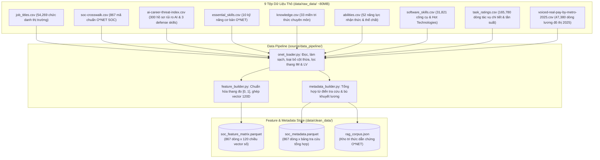
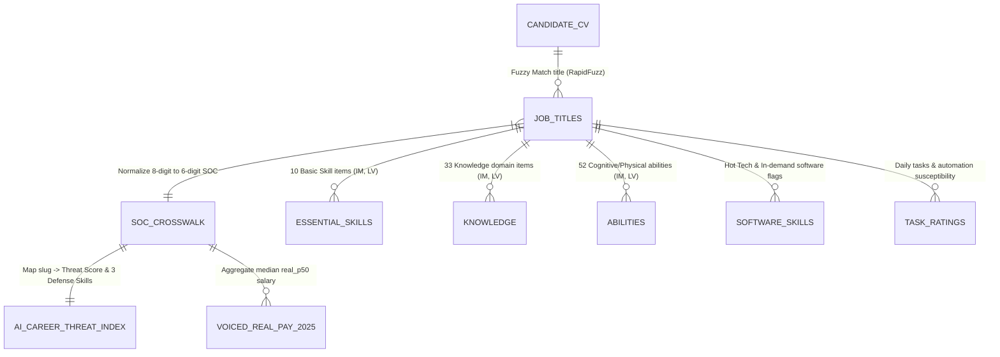

# Cẩm Nang Dữ Liệu Dự Án: AI Recruiter & Career Copilot
## Data Tutorial & Architecture Manual

Tài liệu này cung cấp bức tranh toàn cảnh về **hệ sinh thái 9 tệp dữ liệu thô** (`data/raw_data/`), mối liên kết thực thể (ER Relationships), mục đích sử dụng trong từng phân tầng kiến trúc, và quy chuẩn dữ liệu sạch đầu ra (`data/clean_data/`).

---

## 1. Bản Đồ Hệ Sinh Thái 9 Tệp Dữ Liệu

Hệ thống kết hợp dữ liệu định lượng nguy cơ tự động hóa AI thực tế cùng chuẩn năng lực nghề nghiệp quốc tế **O\*NET (Occupational Information Network)** của Bộ Lao Động Hoa Kỳ:

---

## 2. Sơ Đồ Liên Kết Thực Thể (Entity-Relationship Flow)

Tất cả các bảng dữ liệu liên kết chặt chẽ qua hai chuẩn khóa chính:
1. **8-Digit O\*NET-SOC Code** (`xx-xxxx.xx`, ví dụ `15-1252.00`, `15-1252.01`): Chuẩn chi tiết đến từng chuyên ngành sâu, xuất hiện trong các bảng năng lực O\*NET (`essential_skills`, `knowledge`, `abilities`, `software_skills`, `task_ratings`, `job_titles`).
2. **6-Digit Base SOC Code** (`xx-xxxx`, ví dụ `15-1252`): Chuẩn phân nhóm nghề nghiệp tổng quát, xuất hiện trong `soc-crosswalk.csv`, `ai-career-threat-index.csv`, và `voiced-real-pay-by-metro-2025.csv`.

---

## 3. Ma Trận Phân Phối Dữ Liệu Theo Các Module Hệ Thống

| Tệp Dữ Liệu | Module 1 (Domain) | Module 2 (Data Pipeline) | Module 3 (Parsers) | Module 4 (ML Core) | Module 5 (RAG Engine) | Module 6 (Copilot Agent) | Module 7 (Services) |
| :--- | :---: | :---: | :---: | :---: | :---: | :---: | :---: |
| `job_titles.csv` | | **Khởi tạo Trie / RapidFuzz index** | | | | | Đối sánh chức danh CV |
| `soc-crosswalk.csv` | Khung mã SOC | **Bảng chuẩn hóa 867 mã ngành** | | | | | Tra cứu SOC chuẩn |
| `ai-career-threat-index.csv` | Schema RiskProfile | **Metadata rủi ro & 3 defense skills** | | Label huấn luyện XGBoost | Kho dẫn chứng RAG | Cố vấn ngữ cảnh | Cung cấp điểm rủi ro 0ms |
| `essential_skills.csv` | | **10 chiều vector kỹ năng cơ bản** | | Không gian cụm Agglomerative | | Bóc tách Skill Gap | |
| `knowledge.csv` | | **33 chiều vector tri thức** | | Không gian cụm Agglomerative | | Bóc tách Skill Gap | |
| `abilities.csv` | | **52 chiều vector năng lực** | | Không gian cụm Agglomerative | | Bóc tách Skill Gap | |
| `software_skills.csv` | | **20 chiều công nghệ Hot Tech** | Từ điển entity extraction | Không gian cụm Agglomerative | Kho dẫn chứng công cụ | Đề xuất tech stack chuyển đổi | Khớp kỹ năng kỹ thuật |
| `task_ratings.csv` | | **Lọc tác vụ IM >= 3.0 & RT >= 50%** | | | Trích xuất tác vụ nguy cơ cao | Phản biện tính khả thi | |
| `voiced-real-pay-by-metro-2025.csv` | | **Tính trung vị toàn quốc real_p50** | | Trọng số trong hàm Utility (0.15) | | Bảo toàn thu nhập | So sánh mức lương |

---

## 4. Cấu Trúc Dữ Liệu Sạch Đầu Ra (`data/clean_data/`)

Toàn bộ 9 file CSV thô sau khi chạy qua pipeline sẽ được tinh chế và nén thành **2 tệp Parquet chuẩn hiệu năng cao**:

### 1. `data/clean_data/soc_feature_matrix.parquet`
* **Mục đích**: Đầu vào số học thuần túy phục vụ thuật toán học máy (`AgglomerativeClustering` và `XGBoost`).
* **Kích thước**: Đúng 867 dòng (tương ứng 867 mã O\*NET SOC) $\times$ **120 cột đặc trưng số thực**.
* **Định dạng dữ liệu**: `float32`, đã được chuẩn hóa min-max về khoảng $[0, 1]$, **100% không còn giá trị NaN**.
* **Hiệu năng**: Tốc độ đọc trực tiếp vào `numpy array` hoặc `pandas DataFrame` dưới 15ms.

### 2. `data/clean_data/soc_metadata.parquet`
* **Mục đích**: Từ điển tra cứu thông tin nghề nghiệp tức thì (độ trễ 0ms) cho tầng Use Case Service và làm đầu vào cho RAG Corpus.
* **Cấu trúc trường**:
  - `soc_code`: Mã O\*NET SOC 6 ký tự chuẩn (ví dụ `15-1252`).
  - `soc_title`: Tên nghề nghiệp chính thức theo O\*NET.
  - `threat_score`: Điểm đe dọa tự động hóa AI (0.0 đến 100.0).
  - `risk_level`: Phân loại rủi ro (`Low`, `Moderate`, `High`, `Very High`).
  - `sub_task_automation`, `sub_tool_maturity`, `sub_agentic_exposure`: Phân rã 3 chiều nguy cơ.
  - `defense_skill_1, 2, 3`: Bộ 3 kỹ năng phòng thủ thực chiến trích xuất từ chuyên gia.
  - `insight`: Nhận định chuyên sâu về cơ chế AI thay thế công việc này.
  - `median_salary`: Mức lương trung vị toàn quốc đã điều chỉnh sức mua năm 2025 (kèm fallback).
  - `top_hot_technologies`: Danh sách JSON các công cụ hot của nghề.
  - `critical_tasks`: Danh sách các đầu việc quan trọng và mức độ đe dọa.

---

## 5. Danh Mục Các Tài Liệu Con Trong Thư Mục Này

1. [`01_raw_datasets_guide.md`](file:///c:/Users/Hai%20Nam/full_project/Job_advisor/docs/data_tutorial/01_raw_datasets_guide.md): Bóc tách chi tiết từng tệp CSV thô (ý nghĩa, schema, cột thừa/thiếu, giải pháp bù khuyết).
2. [`02_preprocessing_and_feature_store.md`](file:///c:/Users/Hai%20Nam/full_project/Job_advisor/docs/data_tutorial/02_preprocessing_and_feature_store.md): Hướng dẫn tiền xử lý, công thức toán học chuẩn hóa và cấu tạo chi tiết của Feature Matrix 120 chiều.
