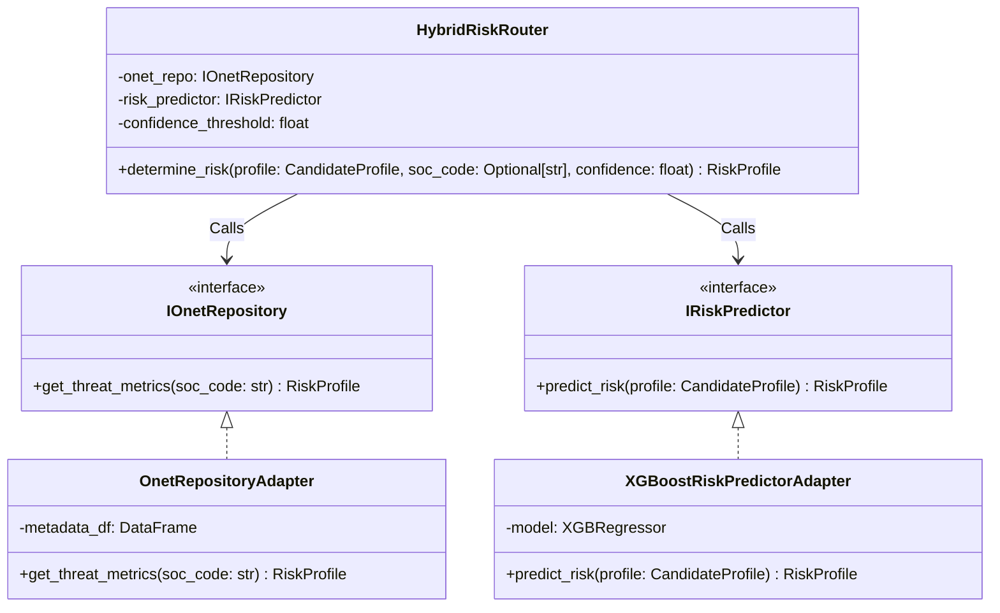
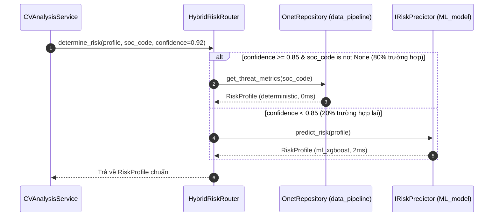

# Pattern 01: Hybrid Router Pattern (Chiến Lược Phân Luồng Ngũ Quan)

---

## 1. Bối Cảnh & Ranh Giới Kiến Trúc Trong Clean Architecture
Trong Clean Architecture, Router không tự mình đi đọc file CSV hay tự tính toán ma trận đặc trưng. 
* Router đóng vai trò là một **Domain / Application Strategy**:
  - Nhận vào Domain Entity: `CandidateProfile`.
  - Nhận vào `confidence_score` từ chức năng đối sánh chức danh.
  - Phân luồng giữa 2 Ports (Interfaces) độc lập:
    1. **`IOnetRepository` (nằm ở `data_pipeline`)**: Tra cứu CSDL chuẩn cho 80% trường hợp có mã ngành O\*NET chuẩn (0ms latency, 100% precision).
    2. **`IRiskPredictor` (nằm ở `model/ML_model`)**: Dự báo học máy (XGBoost) cho 20% vị trí lai hoặc chức danh tự chế.

---

## 2. Sơ Đồ Kiến Trúc & Class Diagram (Ports & Adapters)



---

## 3. Sơ Đồ Tuần Tự Điều Phối (Sequence Diagram)



---

## 4. Khung Code Mẫu Chuẩn Clean Architecture

```python
# source/services/risk_router.py
from typing import Optional
from source.domain.entities.candidate import CandidateProfile
from source.domain.entities.risk import RiskProfile
from source.domain.interfaces.onet_repository import IOnetRepository
from source.domain.interfaces.ml_models import IRiskPredictor

class HybridRiskRouter:
    """
    Router nghiệp vụ phân luồng.
    Hoàn toàn độc lập với chi tiết lưu trữ (CSV/DB) hay chi tiết thư viện ML (XGBoost/Sklearn).
    Chỉ phụ thuộc vào Interfaces: IOnetRepository và IRiskPredictor.
    """
    def __init__(
        self,
        onet_repository: IOnetRepository,
        risk_predictor: IRiskPredictor,
        confidence_threshold: float = 0.85
    ):
        self.onet_repo = onet_repository
        self.risk_predictor = risk_predictor
        self.threshold = confidence_threshold

    def determine_risk(
        self,
        profile: CandidateProfile,
        matched_soc_code: Optional[str],
        match_confidence: float
    ) -> RiskProfile:
        # Nhánh 1: Tra cứu trực tiếp từ CSDL O*NET chuẩn hóa
        if match_confidence >= self.threshold and matched_soc_code:
            deterministic_risk = self.onet_repo.get_threat_metrics(matched_soc_code)
            if deterministic_risk:
                return deterministic_risk

        # Nhánh 2: Chuyển sang mô hình học máy suy diễn vị trí lai
        return self.risk_predictor.predict_risk(profile)
```
