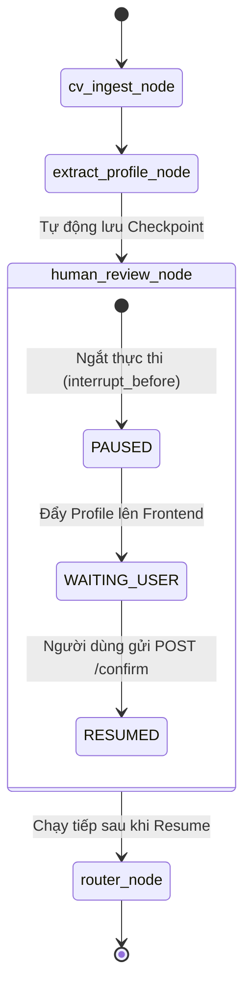
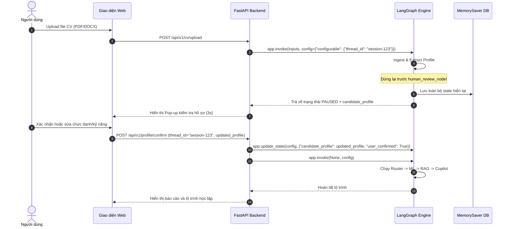

# Pattern 02: Human-in-the-Loop (HITL) State Machine Pattern

---

## 1. Bối Cảnh & Bài Toán Giải Quyết
Khi ứng viên tải CV lên, các thuật toán trích xuất dù dùng LLM mạnh đến đâu vẫn có thể gặp rủi ro:
* Đọc nhầm chức danh (ví dụ: nhầm chức danh trong một dự án cũ thành chức danh chính hiện tại).
* Bỏ sót các kỹ năng cốt lõi hoặc nhận diện sai tên viết tắt công nghệ.

Nếu để các lỗi này truyền tiếp vào các tầng phân cụm, tính điểm rủi ro và sinh lộ trình, hệ thống sẽ đưa ra kết quả sai lệch hoàn toàn (Garbage In, Garbage Out).

**Giải pháp Human-in-the-Loop Pattern**:
* Đặt một điểm ngắt trạng thái (**Interrupt Breakpoint**) ngay sau bước bóc tách CV.
* Hệ thống tạm dừng thực thi, bảo lưu trạng thái phân tích vào bộ nhớ (`checkpointer`).
* Gửi `CandidateProfile` lên giao diện để người dùng kiểm tra nhanh trong 3 giây (xác nhận hoặc sửa đổi chức danh, bổ sung kỹ năng).
* Chỉ khi người dùng bấm xác nhận, hệ thống mới nhận tín hiệu `resume` và chạy tiếp các tầng ML/RAG/Copilot.

---

## 2. Sơ Đồ Trạng Thái & Điểm Ngắt (State Breakpoint Diagram)



---

## 3. Sơ Đồ Tuần Tự (Sequence Diagram)



---

## 4. Contract Interface

```python
from typing import TypedDict, Optional, Dict, Any

class HITLState(TypedDict):
    raw_cv_text: str
    candidate_profile: Optional[Dict[str, Any]]
    user_confirmed: bool  # True nếu người dùng đã xác thực
    thread_id: str
```

---

## 5. Khung Code Mẫu (Skeleton Boilerplate)

```python
# source/model/LLM_model/copilot/graph_hitl.py
from langgraph.graph import StateGraph, START, END
from langgraph.checkpoint.memory import MemorySaver
from source.model.LLM_model.copilot.state import AgentState

def cv_ingest_node(state: AgentState):
    # TODO: Đọc text blocks từ file
    return {"raw_cv_text": "sample text"}

def extract_profile_node(state: AgentState):
    # TODO: Gọi Fast LLM trích xuất JSON
    return {"candidate_profile": {"current_title": "Backend Developer", "skills": ["Python"]}}

def human_review_node(state: AgentState):
    """
    Điểm dừng tương tác.
    Khi graph bị ngắt trước node này, hệ thống sẽ dừng chờ.
    Khi resume, hàm này kiểm tra cờ user_confirmed.
    """
    print(f"Xác nhận hồ sơ cho chức danh: {state['candidate_profile']['current_title']}")
    return {"user_confirmed": True}

# Xây dựng đồ thị
workflow = StateGraph(AgentState)
workflow.add_node("cv_ingest_node", cv_ingest_node)
workflow.add_node("extract_profile_node", extract_profile_node)
workflow.add_node("human_review_node", human_review_node)

workflow.add_edge(START, "cv_ingest_node")
workflow.add_edge("cv_ingest_node", "extract_profile_node")
workflow.add_edge("extract_profile_node", "human_review_node")

# Cấu hình ngắt trước human_review_node
memory = MemorySaver()
app = workflow.compile(
    checkpointer=memory,
    interrupt_before=["human_review_node"]
)
```
