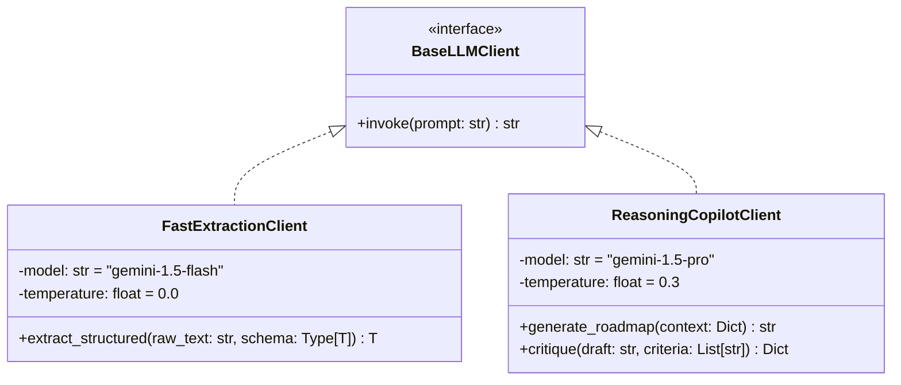

# Pattern 03: Two-Tier LLM Architecture Pattern (Phân Tầng Mô Hình Ngôn Ngữ Lớn)

---

## 1. Bối Cảnh & Bài Toán Giải Quyết
Trong một hệ thống ứng dụng LLM phức tạp, nếu ta dùng **một mô hình duy nhất** cho mọi tác vụ:
* Dùng mô hình đắt tiền (GPT-4o, Gemini 1.5 Pro, Claude 3.5 Sonnet) để bóc tách thông tin từ CV thô: Gây lãng phí chi phí nghiêm trọng (hàng nghìn token input dài với chi phí cao) và độ trễ phản hồi lâu (4-8s).
* Ngược lại, nếu chỉ dùng mô hình nhỏ, giá rẻ (GPT-4o-mini, Gemini 1.5 Flash) để làm cố vấn sự nghiệp: Lời khuyên sẽ bị nông cạn, lập luận yếu, thiếu chiều sâu chiến lược và dễ sinh biểu đồ sai cú pháp.

**Giải pháp Two-Tier LLM Architecture Pattern**:
Hệ thống phân tầng rõ rệt 2 lớp mô hình với vai trò và mục tiêu tối ưu riêng biệt:
1. **Tier 1 - Fast Extraction LLM**:
   - Mục tiêu: Tốc độ cao (< 2s), chi phí cực thấp (~$0.0001/CV), tuân thủ 100% Pydantic Schema.
   - Mô hình ứng viên: `Gemini 1.5 Flash` hoặc `GPT-4o-mini`.
   - Cơ chế: `with_structured_output(CandidateProfile)`.
2. **Tier 2 - Advanced Reasoning LLM**:
   - Mục tiêu: Chiều sâu tư duy, khả năng lý luận chiến lược phức tạp, tổng hợp đa nguồn (O\*NET + ML + RAG), sinh kế hoạch 30-60-90 ngày sâu sắc và biểu đồ Mermaid chuẩn xác.
   - Mô hình ứng viên: `Gemini 1.5 Pro`, `GPT-4o`, hoặc `Claude 3.5 Sonnet`.

---

## 2. Bảng So Sánh 2 Tầng Mô Hình

| Đặc tính | Tầng 1: Fast Extraction Tier | Tầng 2: Reasoning Copilot Tier |
| :--- | :--- | :--- |
| **Nhiệm vụ chính** | Bóc tách text CV $\rightarrow$ Pydantic Schema | Lý luận chiến lược, tổng hợp RAG, sinh lộ trình |
| **Mô hình khuyến nghị** | `gemini-1.5-flash` / `gpt-4o-mini` | `gemini-1.5-pro` / `gpt-4o` / `claude-3-5-sonnet` |
| **Độ trễ trung bình** | < 1.5 giây | 5 – 10 giây (sinh văn bản dài chuyên sâu) |
| **Chi phí ước tính** | ~$0.0001 / lượt gọi | ~$0.01 – $0.03 / lượt gọi |
| **Cơ chế kiểm soát** | Ép kiểu Schema (JSON Mode / Tool Calling) | Prompt Engineering phân vai + Grounding Rules |

---

## 3. Sơ Đồ Kiến Trúc Class Diagram



---

## 4. Khung Code Mẫu (Skeleton Boilerplate)

```python
# source/model/LLM_model/llm_factory.py
from typing import Type, TypeVar
from pydantic import BaseModel
from langchain_google_genai import ChatGoogleGenerativeAI
from source.infrastructure.config import settings

T = TypeVar("T", bound=BaseModel)

class LLMFactory:
    @staticmethod
    def get_fast_model():
        """Tầng 1: Dành cho trích xuất thông tin, tốc độ cao, nhiệt độ = 0 để chống ảo giác."""
        return ChatGoogleGenerativeAI(
            model=settings.FAST_LLM_MODEL,
            google_api_key=settings.GEMINI_API_KEY,
            temperature=0.0,
            max_retries=3
        )

    @staticmethod
    def get_reasoning_model():
        """Tầng 2: Dành cho phân tích chuyên sâu, lập luận cố vấn sự nghiệp."""
        return ChatGoogleGenerativeAI(
            model=settings.REASONING_LLM_MODEL,
            google_api_key=settings.GEMINI_API_KEY,
            temperature=0.3,
            max_retries=2
        )

# Ví dụ cách sử dụng Tầng 1 (Fast Extraction)
def extract_profile_with_tier1(raw_cv_text: str, schema: Type[T]) -> T:
    fast_llm = LLMFactory.get_fast_model()
    structured_llm = fast_llm.with_structured_output(schema)
    prompt = f"Trích xuất thông tin hồ sơ ứng viên từ nội dung CV sau:\n\n{raw_cv_text}"
    return structured_llm.invoke(prompt)

# Ví dụ cách sử dụng Tầng 2 (Reasoning Copilot)
def generate_roadmap_with_tier2(context_prompt: str) -> str:
    reasoning_llm = LLMFactory.get_reasoning_model()
    response = reasoning_llm.invoke(context_prompt)
    return response.content
```
