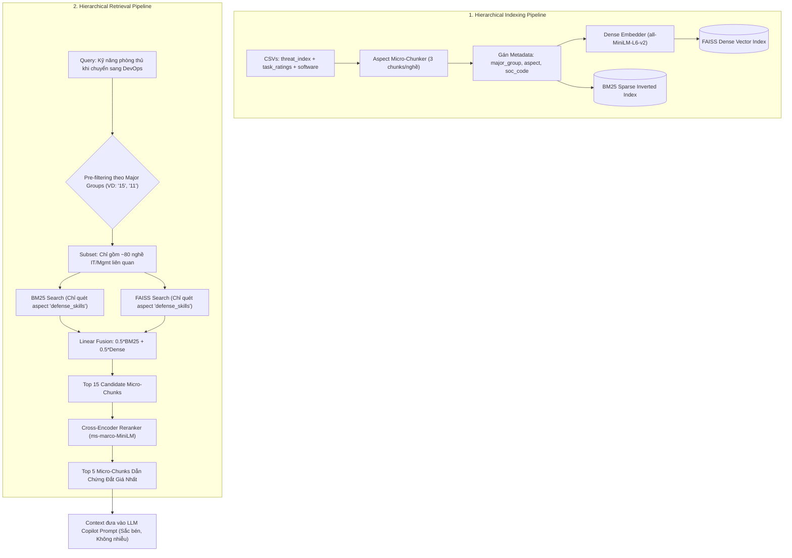

# Pattern 04: Hierarchical Aspect-Based RAG Pattern (Mỏ Neo Sự Thật Phân Tầng Theo Khía Cạnh)

---

## 1. Bối Cảnh & Bài Toán Giải Quyết
Trong bài toán cố vấn nghề nghiệp chuyển đổi, nếu chỉ dùng Prompt và dựa vào tri thức nội tại của LLM hoặc dùng RAG phẳng toàn cục (Global Flat RAG), hệ thống sẽ gặp 3 vấn đề chí mạng:
1. **Ảo giác chứng chỉ & khóa học**: LLM tự bịa ra các chứng chỉ không tồn tại hoặc các khóa học không được công nhận trong ngành.
2. **Nhiễu ngữ nghĩa xuyên ngành (Cross-domain Semantic Noise)**: Truy vấn về kỹ năng phòng thủ cho lập trình viên nhưng bộ tìm kiếm vector lại kéo về các đoạn văn bản của... *Chuyên viên tài chính hay Nghiên cứu sinh học* chỉ vì cùng chứa từ khóa chung chung như "phân tích dữ liệu", "báo cáo".
3. **Pha loãng vector embedding (Embedding Dilution)**: Nếu nhồi nhét cả đống thông tin (cơ chế đe dọa, lương, tác vụ, 20 công cụ) vào 1 chunk dài, vector embedding sẽ là một "trung bình cộng mờ nhạt", làm giảm độ chính xác khi tìm kiếm khía cạnh cụ thể.

**Giải pháp Hierarchical Aspect-Based RAG Pattern**:
* **Phân vùng dữ liệu (Domain Partitioning)**: Chia kho tri thức theo 23 nhóm ngành lớn O\*NET (`major_group`). Khi truy vấn, chỉ quét trong namespace của nghề hiện tại và nhóm nghề an toàn mục tiêu $\rightarrow$ Triệt tiêu 100% nhiễu xuyên ngành.
* **Xé nhỏ theo khía cạnh nghiệp vụ (Aspect-Based Micro-Chunking)**: Mỗi nghề O\*NET được bóc tách thành đúng 3 micro-chunks độc lập (150–200 tokens):
  1. `threat_mechanism`: Cơ chế AI đe dọa và tác nhân thay thế (Devin, Auto-QA, Agentic AI).
  2. `defense_skills`: 3 kỹ năng phòng thủ thực chiến và cách rèn luyện.
  3. `tasks_and_tools`: Tác vụ tự động hóa nguy cơ cao và công cụ Hot Tech cần học để chuyển dịch.
* **Hybrid Search + Targeted Filtering**: Kết hợp Pre-filtering theo nhóm ngành, lọc theo `aspect`, chạy BM25 + FAISS và tinh lọc lại qua **Cross-Encoder Reranker**.

---

## 2. Sơ Đồ Kiến Trúc Thành Phần (Component Diagram)



---

## 3. Metadata Schema của Grounded Chunk

```python
from pydantic import BaseModel, Field
from typing import Optional, List, Dict, Any

class GroundedChunk(BaseModel):
    chunk_id: str = Field(..., description="Unique chunk ID: soc_15-1252_defense")
    soc_code: str = Field(..., description="6-digit O*NET SOC code (e.g. '15-1252')")
    major_group: str = Field(..., description="2-digit O*NET Major Group (e.g. '15' for IT, '11' for Mgmt)")
    role_title: str = Field(..., description="Official occupation title")
    aspect: str = Field(..., description="'threat_mechanism', 'defense_skills', or 'tasks_and_tools'")
    content: str = Field(..., description="Concise text content (150-200 tokens)")
    threat_score: Optional[float] = None
    defense_skills: List[str] = Field(default_factory=list)
    hot_technologies: List[str] = Field(default_factory=list)
    critical_tasks: List[str] = Field(default_factory=list)
```

---

## 4. Khung Code Mẫu (Skeleton Boilerplate)

```python
# source/model/LLM_model/rag/retriever.py
import faiss
import numpy as np
from typing import List, Optional, Set
from rank_bm25 import BM25Okapi
from sentence_transformers import SentenceTransformer, CrossEncoder

class HierarchicalEvidenceRAG:
    """
    Triển khai IEvidenceRetriever từ Domain Interfaces.
    Hỗ trợ lọc namespace theo major_group và aspect trước khi tính điểm Hybrid Search.
    """
    def __init__(
        self,
        chunks: List[dict],
        embedding_model_name: str = "sentence-transformers/all-MiniLM-L6-v2",
        reranker_model_name: str = "cross-encoder/ms-marco-MiniLM-L-6-v2"
    ):
        self.chunks = chunks
        self.embedder = SentenceTransformer(embedding_model_name)
        self.reranker = CrossEncoder(reranker_model_name)

        # Xây dựng BM25 index trên toàn bộ corpus
        tokenized_corpus = [chunk["content"].lower().split(" ") for chunk in chunks]
        self.bm25 = BM25Okapi(tokenized_corpus)

        # Xây dựng FAISS Dense index
        embeddings = self.embedder.encode([chunk["content"] for chunk in chunks], convert_to_numpy=True)
        dimension = embeddings.shape[1]
        faiss.normalize_L2(embeddings)
        self.faiss_index = faiss.IndexFlatIP(dimension)
        self.faiss_index.add(embeddings)

    def retrieve(
        self,
        query: str,
        major_groups: Optional[List[str]] = None,
        aspects: Optional[List[str]] = None,
        top_k: int = 5
    ) -> List[dict]:
        # Bước 1: Xác định tập chỉ số hợp lệ sau khi Pre-filtering (Lọc namespace và khía cạnh)
        valid_indices: Set[int] = set(range(len(self.chunks)))
        if major_groups:
            mg_set = set(major_groups)
            valid_indices = {i for i in valid_indices if self.chunks[i].get("major_group") in mg_set}
        if aspects:
            asp_set = set(aspects)
            valid_indices = {i for i in valid_indices if self.chunks[i].get("aspect") in asp_set}

        if not valid_indices:
            valid_indices = set(range(len(self.chunks)))

        # Bước 2: BM25 Sparse Search trên tập hợp lệ
        tokenized_query = query.lower().split(" ")
        bm25_scores = self.bm25.get_scores(tokenized_query)
        # Chỉ lấy điểm của các indices hợp lệ
        filtered_bm25 = [(i, bm25_scores[i]) for i in valid_indices]
        filtered_bm25.sort(key=lambda x: x[1], reverse=True)
        top_bm25_indices = [x[0] for x in filtered_bm25[:20]]

        # Bước 3: FAISS Dense Search với query vector
        query_vec = self.embedder.encode([query], convert_to_numpy=True)
        faiss.normalize_L2(query_vec)
        _, raw_faiss_indices = self.faiss_index.search(query_vec, min(50, len(self.chunks)))
        top_faiss_indices = [idx for idx in raw_faiss_indices[0] if idx in valid_indices][:20]

        # Bước 4: Hợp nhất tập ứng viên
        candidate_indices = list(set(top_bm25_indices).union(set(top_faiss_indices)))
        candidate_chunks = [self.chunks[i] for i in candidate_indices]

        # Bước 5: Cross-Encoder Reranking
        pairs = [[query, chunk["content"]] for chunk in candidate_chunks]
        rerank_scores = self.reranker.predict(pairs)
        ranked_indices = np.argsort(rerank_scores)[-top_k:][::-1]

        return [candidate_chunks[i] for i in ranked_indices]
```
