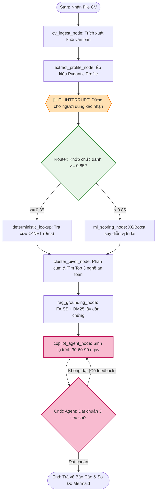

# Pattern 05: LangGraph Multi-Agent State Machine Pattern

---

## 1. Bối Cảnh & Bài Toán Giải Quyết
Một pipeline xử lý tuyến tính (Sequential Pipeline như `LangChain SimpleSequentialChain`) bộc lộ 4 điểm yếu chí mạng khi đối mặt với các bài toán thực tế:
1. **Dễ đứt gãy dây chuyền**: Nếu một bước xảy ra ngoại lệ hoặc người dùng muốn sửa dữ liệu, toàn bộ chuỗi phải chạy lại từ đầu.
2. **Không có khả năng rẽ nhánh động**: Không thể chuyển hướng linh hoạt giữa tra cứu bảng (Deterministic) và chạy mô hình học máy (XGBoost).
3. **Không hỗ trợ tương tác tạm dừng tự nhiên (Human-in-the-Loop)**: Rất khó để tạm dừng luồng và chờ người dùng duyệt rồi mới chạy tiếp.
4. **Không có cơ chế tự kiểm định và tự sửa lỗi (Self-Correction & Reflection Loop)**: Lộ trình sinh ra nếu bị lỗi cú pháp hoặc thiếu thông tin thì không có cách nào tự động yêu cầu LLM viết lại.

**Giải pháp LangGraph State Machine Pattern**:
Mô hình hóa toàn bộ hệ thống thành một **Máy trạng thái hữu hạn có hướng (Stateful Multi-Agent Graph)**:
* Quản lý trạng thái tập trung thông qua `AgentState` TypedDict.
* Sử dụng **Conditional Edges** để rẽ nhánh thông minh.
* Tích hợp **Checkpoint MemorySaver** cho phép ngắt (`interrupt_before`) để người dùng kiểm chứng trong 3 giây.
* Xây dựng cặp tác tử **Generator (Copilot)** và **Evaluator (Critic)** tạo thành vòng lặp tự phản biện và tự sửa sai trước khi trả về kết quả cuối cùng.

---

## 2. Sơ Đồ Trạng Thái Chi Tiết & Vòng Lặp Phản Biện



---

## 3. Schema Định Nghĩa Trạng Thái Toàn Cục (`AgentState`)

```python
from typing import TypedDict, Optional, List, Dict, Any

class AgentState(TypedDict):
    # Dữ liệu tầng Ingestion
    raw_cv_text: str
    candidate_profile: Optional[Dict[str, Any]]
    user_confirmed: bool

    # Dữ liệu tầng Router & Matching
    matched_soc_code: Optional[str]
    matched_title: Optional[str]
    match_confidence: float

    # Dữ liệu tầng ML & Phân cụm
    risk_metrics: Optional[Dict[str, Any]]      # Threat score, level, sub_scores
    safe_pivot_roles: Optional[List[Dict[str, Any]]] # Top 3 nghề an toàn
    skill_gap: Optional[Dict[str, Any]]         # strengths, vulnerable, defense

    # Dữ liệu tầng RAG
    grounding_evidence: Optional[List[Dict[str, str]]]

    # Dữ liệu tầng Copilot & Critic Loop
    draft_roadmap: Optional[str]
    critic_review: Optional[Dict[str, Any]]     # {"approved": bool, "feedback": str}
    iteration_count: int                       # Giới hạn số lần tự phản biện (max 2 lần)
    final_output: Optional[str]
```

---

## 4. Khung Code Mẫu Xây Dựng & Biên Dịch StateGraph

```python
# source/model/LLM_model/copilot/graph.py
from langgraph.graph import StateGraph, START, END
from langgraph.checkpoint.memory import MemorySaver
from source.model.LLM_model.copilot.state import AgentState

# 1. Định nghĩa các hàm Router điều kiện (Conditional Routing)
def route_after_matcher(state: AgentState) -> str:
    if state.get("match_confidence", 0.0) >= 0.85 and state.get("matched_soc_code"):
        return "deterministic_lookup"
    return "ml_scoring_node"

def route_after_critic(state: AgentState) -> str:
    critic = state.get("critic_review", {})
    iteration = state.get("iteration_count", 0)
    
    # Nếu đạt chuẩn hoặc đã phản biện quá 2 lần -> kết thúc
    if critic.get("approved", False) or iteration >= 2:
        return END
    return "copilot_agent_node"

# 2. Xây dựng Workflow
def build_copilot_graph():
    workflow = StateGraph(AgentState)

    # Thêm các Nodes (được import từ nodes.py)
    workflow.add_node("cv_ingest_node", cv_ingest_node)
    workflow.add_node("extract_profile_node", extract_profile_node)
    workflow.add_node("human_review_node", human_review_node)
    workflow.add_node("deterministic_lookup", deterministic_lookup)
    workflow.add_node("ml_scoring_node", ml_scoring_node)
    workflow.add_node("cluster_pivot_node", cluster_pivot_node)
    workflow.add_node("rag_grounding_node", rag_grounding_node)
    workflow.add_node("copilot_agent_node", copilot_agent_node)
    workflow.add_node("critic_evaluator_node", critic_evaluator_node)

    # Kết nối các Edges
    workflow.add_edge(START, "cv_ingest_node")
    workflow.add_edge("cv_ingest_node", "extract_profile_node")
    workflow.add_edge("extract_profile_node", "human_review_node")

    # Conditional Edge sau bước xác nhận của người dùng
    workflow.add_conditional_edges(
        "human_review_node",
        route_after_matcher,
        {
            "deterministic_lookup": "deterministic_lookup",
            "ml_scoring_node": "ml_scoring_node"
        }
    )

    workflow.add_edge("deterministic_lookup", "cluster_pivot_node")
    workflow.add_edge("ml_scoring_node", "cluster_pivot_node")
    workflow.add_edge("cluster_pivot_node", "rag_grounding_node")
    workflow.add_edge("rag_grounding_node", "copilot_agent_node")
    workflow.add_edge("copilot_agent_node", "critic_evaluator_node")

    # Conditional Edge cho vòng lặp phản biện của Critic
    workflow.add_conditional_edges(
        "critic_evaluator_node",
        route_after_critic,
        {
            "copilot_agent_node": "copilot_agent_node",
            END: END
        }
    )

    # Biên dịch đồ thị với Checkpointer và điểm ngắt HITL
    memory = MemorySaver()
    app = workflow.compile(
        checkpointer=memory,
        interrupt_before=["human_review_node"]
    )
    return app
```
