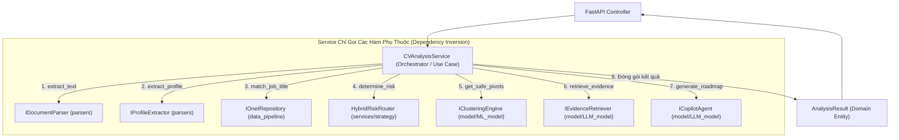

# Pattern 06: Clean Architecture Orchestrator (Use Case / Application Service Pattern)

---

## 1. Bối Cảnh & Triết Lý Thiết Kế
Một lỗi phổ biến trong phát triển phần mềm và hệ thống Machine Learning là **"God Service"** (Service làm tất cả mọi thứ):
* Service vừa mở file PDF, vừa bóc tách văn bản.
* Service vừa đọc trực tiếp 9 file CSV, vừa merge bảng, vừa chuẩn hóa số liệu.
* Service vừa chạy vòng lặp XGBoost, vừa format JSON trả cho người dùng.

Hậu quả:
* Code bị phụ thuộc chặt (Tight Coupling), không thể viết Unit Test độc lập.
* Khi đổi định dạng file hoặc nâng cấp mô hình AI, tầng Service phải viết lại toàn bộ.

**Quy Tắc Vàng Của Clean Architecture**:
> **"Service chỉ là Nhạc Trưởng (Orchestrator) – Nó chỉ gọi các hàm chức năng đến theo kịch bản nghiệp vụ, tuyệt đối không tự mình thực hiện các tác vụ kỹ thuật cấp thấp."**

```
┌─────────────────────────────────────────────────────────────────────────────────┐
│                           PHÂN ĐỊNH TRÁCH NHIỆM RÕ RÀNG                          │
├───────────────────┬─────────────────────────────────────────────────────────────┤
│ Tầng Kiến Trúc    │ Trách nhiệm duy nhất                                        │
├───────────────────┼─────────────────────────────────────────────────────────────┤
│ 1. Domain         │ Định nghĩa Entity chuẩn (`CandidateProfile`, `RiskProfile`) │
│                   │ và Interfaces (Ports). Hoàn toàn độc lập mọi thư viện.      │
├───────────────────┼─────────────────────────────────────────────────────────────┤
│ 2. Data Pipeline  │ Chuyên trách đọc, làm sạch, biến đổi 9 CSV O*NET, tạo       │
│                   │ Feature Store Parquet và cung cấp Repository tra cứu.       │
├───────────────────┼─────────────────────────────────────────────────────────────┤
│ 3. Parsers        │ Adapter chuyên trách đọc định dạng nhị phân PDF/DOCX.       │
├───────────────────┼─────────────────────────────────────────────────────────────┤
│ 4. ML / LLM Model │ Adapter chuyên trách tính toán giải thuật (Clustering,      │
│                   │ XGBoost, Vector Search, State Machine).                     │
├───────────────────┼─────────────────────────────────────────────────────────────┤
│ 5. Services       │ NHẠC TRƯỞNG: Gọi Parser -> Gọi Repository -> Gọi Router ->  │
│    (Use Cases)    │ Gọi ML/LLM -> Tập hợp kết quả trả về.                       │
├───────────────────┼─────────────────────────────────────────────────────────────┤
│ 6. API Controllers│ Nhận HTTP Request, validate, chuyển cho Service, trả HTTP.  │
└───────────────────┴─────────────────────────────────────────────────────────────┘
```

---

## 2. Sơ Đồ Kiến Trúc Nhạc Trưởng (Orchestrator Diagram)



---

## 3. Khung Code Mẫu (Skeleton Boilerplate)

```python
# source/services/cv_analysis_service.py
from pathlib import Path
from typing import Dict, Any

from source.domain.entities.candidate import CandidateProfile
from source.domain.entities.risk import RiskProfile
from source.domain.entities.roadmap import CopilotRoadmap
from source.domain.interfaces.parser import IDocumentParser, IProfileExtractor
from source.domain.interfaces.onet_repository import IOnetRepository
from source.domain.interfaces.ml_models import IClusteringEngine
from source.domain.interfaces.rag import IEvidenceRetriever
from source.domain.interfaces.copilot_agent import ICopilotAgent
from source.services.risk_router import HybridRiskRouter

class CVAnalysisService:
    """
    Use Case Orchestrator:
    Chỉ inject các interfaces và gọi các hàm đến, không tự bóc tách text hay tính toán toán học.
    """
    def __init__(
        self,
        parser: IDocumentParser,
        extractor: IProfileExtractor,
        onet_repo: IOnetRepository,
        router: HybridRiskRouter,
        clustering_engine: IClusteringEngine,
        rag_retriever: IEvidenceRetriever,
        copilot_agent: ICopilotAgent
    ):
        self.parser = parser
        self.extractor = extractor
        self.onet_repo = onet_repo
        self.router = router
        self.clustering = clustering_engine
        self.rag = rag_retriever
        self.copilot = copilot_agent

    def execute_full_pipeline(self, cv_file_path: Path) -> Dict[str, Any]:
        # Bước 1: Gọi Parser lấy text thô
        raw_text = self.parser.extract_text(cv_file_path)

        # Bước 2: Gọi Extractor bóc tách thành Domain Entity
        profile: CandidateProfile = self.extractor.extract_profile(raw_text)

        # Bước 3: Gọi Repository đối sánh chức danh O*NET
        soc_code, matched_title, confidence = self.onet_repo.match_job_title(profile.current_title)

        # Bước 4: Gọi Router quyết định rẽ nhánh tra cứu hay chạy mô hình ML
        risk_profile: RiskProfile = self.router.determine_risk(profile, soc_code, confidence)

        # Bước 5: Gọi Clustering Engine tìm Top nghề an toàn lân cận
        safe_pivots = self.clustering.get_safe_pivots(soc_code, risk_profile.threat_score)

        # Bước 6: Gọi RAG Engine lấy dẫn chứng mỏ neo sự thật
        evidences = self.rag.retrieve_evidence(query=profile.current_title, top_k=5)

        # Bước 7: Gọi Copilot Agent sinh lộ trình hành động 30-60-90 ngày
        roadmap: CopilotRoadmap = self.copilot.generate_roadmap(
            profile=profile,
            risk_profile=risk_profile,
            safe_pivots=safe_pivots,
            evidences=evidences
        )

        # Bước 8: Trả về kết quả hoàn chỉnh cho Controller
        return {
            "candidate_profile": profile,
            "risk_profile": risk_profile,
            "safe_pivots": safe_pivots,
            "roadmap": roadmap
        }
```
