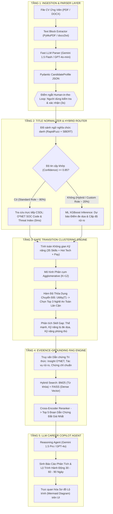
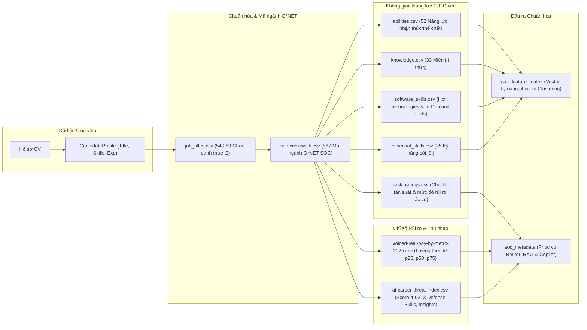
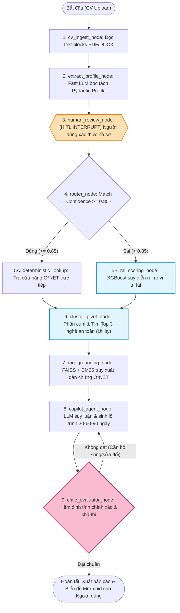

# TÀI LIỆU THIẾT KẾ KIẾN TRÚC HỆ THỐNG
## AI Recruiter & Career Copilot: Nền tảng Định lượng Rủi ro Tự động hóa AI và Cố vấn Chuyển đổi Kỹ năng Nghề nghiệp Cá nhân hóa

---

## 1. Sơ Lược Hệ Thống (System Overview)

### 1.1. Bối cảnh & Bài toán
Sự bùng nổ của các mô hình ngôn ngữ lớn (LLMs) và các hệ thống tác tử tự chủ (**Agentic AI** như Devin, Claude Code, Auto-QA, AI Helpdesks) đang tạo ra nguy cơ thay thế chưa từng có đối với nhóm lao động nhận thức bậc cao (High-Cognitive White-Collar Jobs: Lập trình viên, QA/Tester, IT Support, Data Analyst, Quản trị hệ thống,...).

Các nền tảng tuyển dụng truyền thống (LinkedIn, TopCV, Indeed) bộc lộ 3 khoảng trống lớn:
1. **Chỉ khớp lệnh tĩnh ở hiện tại**: Trả lời câu hỏi *"Hôm nay bạn làm được gì?"* thay vì dự báo tương lai.
2. **Thiếu thước đo định lượng**: Không đo lường được mức độ rủi ro tự động hóa công việc trong 1–3 năm tới.
3. **Thiếu định hướng chuyển đổi (Reskilling Gap)**: Không chỉ ra được khoảng cách kỹ năng cụ thể giữa nghề hiện tại và các nghề an toàn hơn, cũng như không đề xuất được các **Kỹ năng phòng thủ AI (AI Defense Skills)**.

### 1.2. Mục tiêu & Giá trị Cốt lõi của AI Career Copilot
Hệ thống đóng vai trò là một **Trợ lý Cố vấn Nghề nghiệp Độc lập**, cung cấp 3 giá trị trọng tâm:
* **Định lượng rủi ro AI khách quan**: Điểm đe dọa (Score 4–92), phân rã chi tiết thành rủi ro tác vụ (`sub_task_automation`), độ chín muồi công cụ (`sub_tool_maturity`), và mức độ tiếp xúc tác tử tự chủ (`sub_agentic_exposure`).
* **Định vị cụm nghề an toàn (Safe Career Pivot)**: Dùng mô hình phân cụm không gian kỹ năng để tìm các nghề lân cận có mức độ trùng lặp kỹ năng cao nhất (60–80%) và bảo toàn thu nhập thực tế.
* **Lộ trình hành động thực chiến 30 - 60 - 90 ngày**: Kết hợp RAG Engine và LLM Copilot để sinh kế hoạch học tập cá nhân hóa, bám sát các kỹ năng phòng thủ AI và chứng chỉ chuẩn công nghiệp.

---

## 2. Các Architectural & Design Patterns Cốt Lõi

Hệ thống được thiết kế dựa trên 5 Design Patterns chủ đạo:

```
┌──────────────────────────────────────────────────────────────────────────────────┐
│                             5 CORE DESIGN PATTERNS                               │
├──────────────────────┬────────────────────────┬──────────────────────────────────┤
│ Pattern              │ Phạm vi ứng dụng       │ Lợi ích kỹ thuật mang lại        │
├──────────────────────┼────────────────────────┼──────────────────────────────────┤
│ 1. Hybrid Router     │ Định tuyến chức danh   │ Tối ưu tốc độ (0ms), độ chính    │
│    Pattern           │ và tính điểm rủi ro    │ xác 100% cho 80% trường hợp; ML  │
│                      │                        │ xử lý 20% vị trí lai (hybrid).   │
├──────────────────────┼────────────────────────┼──────────────────────────────────┤
│ 2. Human-in-the-Loop │ Xác thực hồ sơ ứng     │ Dừng 3s cho người dùng xác nhận  │
│    (HITL) Pattern    │ viên sau bóc tách CV   │ profile; triệt tiêu hoàn toàn    │
│                      │                        │ ảo giác (hallucination) đầu vào. │
├──────────────────────┼────────────────────────┼──────────────────────────────────┤
│ 3. Two-Tier LLM      │ Phân tầng mô hình ngôn │ Tối ưu chi phí & tốc độ: Fast    │
│    Architecture      │ ngữ lớn theo tác vụ    │ LLM cho Parser (<2s, ~$0.0001);  │
│                      │                        │ Reasoning LLM cho Copilot Agent. │
├──────────────────────┼────────────────────────┼──────────────────────────────────┤
│ 4. Evidence          │ Cố vấn & sinh lộ trình │ Đóng vai trò 'Mỏ neo sự thật';   │
│    Grounding RAG     │ học tập thích ứng      │ mọi lời khuyên đều gắn với dẫn   │
│                      │                        │ chứng O*NET và 3 defense skills. │
├──────────────────────┼────────────────────────┼──────────────────────────────────┤
│ 5. Stateful Multi-   │ Điều phối luồng xử lý  │ Linh hoạt rẽ nhánh, hỗ trợ dừng  │
│    Agent Graph       │ phân tích toàn hệ thống│ chờ (interrupt) và vòng lặp tự   │
│    (LangGraph)       │                        │ phản biện (Self-Correction Loop).│
└──────────────────────┴────────────────────────┴──────────────────────────────────┘
```

---

## 3. Hình Vẽ Thiết Kế Hệ Thống (Visual System Diagrams)

### 3.1. Sơ đồ Kiến trúc Tổng thể 5 Phân tầng (Overall 5-Layer Architecture)



---

### 3.2. Sơ đồ Dòng Chảy Thực Thể Dữ Liệu (ER & Data Pipeline Flow)

Hệ thống kết nối chặt chẽ giữa 9 file CSV dữ liệu chuẩn quốc tế và hồ sơ ứng viên thông qua mã chuẩn **O*NET SOC Code**:



---

### 3.3. Sơ đồ Máy Trạng Thái LangGraph Multi-Agent (StateGraph)

Điều phối toàn bộ quy trình qua State Machine có trạng thái tập trung (`AgentState`), hỗ trợ điểm ngắt tương tác người dùng (HITL) và vòng lặp tự phản biện (Self-Correction Loop):



---

## 4. Bản Đồ Tổ Chức Cấu Trúc Thư Mục Dự Án (Clean Architecture Blueprint)

Cấu trúc mã nguồn của dự án được tổ chức bám sát theo nguyên lý phân tách trách nhiệm (Separation of Concerns) của **Clean Architecture**:

```
Job_advisor/
├── .github/
│   └── workflows/                # CI/CD pipelines (Automated tests, linting)
├── data/
│   ├── raw_data/                 # 9 file CSV dữ liệu O*NET & AI Threat gốc
│   └── clean_data/               # Dữ liệu sạch, vector đặc trưng & feature store
├── deploy/                       # Cấu hình Docker, docker-compose, scripts triển khai
├── docs/                         # Tài liệu hệ thống
│   ├── pattern_design/           # Đặc tả chi tiết 6 Design Patterns (Class & Sequence Diagrams)
│   ├── system_design/            # Tài liệu thiết kế kiến trúc hệ thống tổng thể
│   └── tasks/                    # Danh sách task code tay chi tiết từng module (Phase 0 -> Phase 8)
├── source/                       # Mã nguồn chính của ứng dụng
│   ├── __init__.py
│   ├── domain/                   # [LÕI HỆ THỐNG] Độc lập tuyệt đối với thư viện ngoài
│   │   ├── entities/             # candidate, onet, risk, roadmap
│   │   ├── interfaces/           # Ports/Protocols: IParser, IOnetRepository, IClustering, IRiskModel
│   │   └── exceptions.py         # Domain business exceptions
│   ├── data_pipeline/            # [DATA ENGINEERING] Xử lý 9 CSV, tạo feature store, O*NET Repo
│   │   ├── onet_loader.py
│   │   ├── feature_builder.py    # Sinh soc_feature_matrix.parquet & metadata
│   │   └── onet_repository.py    # Triển khai IOnetRepository (Deterministic lookup)
│   ├── parsers/                  # [ADAPTER INGESTION] Chỉ làm nhiệm vụ đọc file PDF/DOCX
│   │   ├── document_parser.py    # PyMuPDF blocks extractor
│   │   └── llm_profile_parser.py # Fast LLM Adapter điền vào domain.CandidateProfile
│   ├── model/                    # [AI & MACHINE LEARNING]
│   │   ├── ML_model/             # Phân cụm Agglomerative (K=12), Transition Utility, XGBoost + SHAP
│   │   └── LLM_model/            # FAISS + BM25 RAG Retriever, LangGraph State Machine
│   ├── services/                 # [APPLICATION USE CASES] NHẠC TRƯỞNG chỉ gọi hàm điều phối
│   │   ├── risk_router.py        # Chiến lược phân luồng Tra cứu vs Mô hình học máy
│   │   ├── cv_analysis_service.py# Orchestrator: Parser -> Repo -> Router -> ML -> RAG -> Copilot
│   │   └── hitl_service.py       # Quản lý resume workflow người dùng xác nhận
│   ├── infrastructure/           # [DRIVEN ADAPTERS] Cấu hình settings (.env), CSDL session
│   └── api/                      # [DRIVING ADAPTER] FastAPI controllers, routers, middlewares
├── tests/                        # Bộ kiểm thử tự động (Unit test, Integration test, E2E)
├── .gitignore                    # Bỏ qua datasets nặng, cache, môi trường ảo (.venv)
└── requirements.txt              # Danh sách thư viện phụ thuộc của dự án
```

### Bảng Phân Định Ranh Giới Trách Nhiệm Trong `source/`:

| Tầng / Thư mục | Vai trò trong Clean Architecture | Trách nhiệm duy nhất |
| :--- | :--- | :--- |
| **`source/domain/`** | Core Domain | Chứa toàn bộ Data Entities, Value Objects và Interface Contracts (Protocols). Không import thư viện ngoài. |
| **`source/data_pipeline/`**| Data Engineering | Tải, làm sạch, tính toán ma trận đặc trưng Parquet từ 9 CSV; triển khai `OnetRepository`. |
| **`source/parsers/`** | Ingestion Adapter | Chỉ đọc byte nhị phân PDF/DOCX, trích xuất text block và gọi Fast LLM để ánh xạ vào `CandidateProfile`. |
| **`source/model/`** | AI / ML Adapters | Triển khai các giải thuật toán học: Phân cụm Agglomerative, XGBoost, FAISS Vector Search, LangGraph. |
| **`source/services/`** | Use Cases (Orchestrator) | **Nhạc trưởng**: Chỉ nhận yêu cầu và điều phối gọi các hàm từ Parser, Repository, ML, RAG, Copilot. Tuyệt đối không ôm đồm xử lý dữ liệu thô. |
| **`source/infrastructure/`**| Driven Adapters | Quản lý biến môi trường (`pydantic-settings`), kết nối Database ORM, External API clients. |
| **`source/api/`** | Driving Adapter | Tiếp nhận HTTP Request, validate, chuyển cho Service tương ứng và định dạng HTTP Response trả về. |
