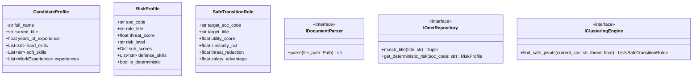

# Module 1: Domain Entities & Interfaces (Lõi Nghiệp Vụ Miền)

---

## 1. Mục Tiêu Module
Thiết lập tầng **Domain** - trái tim của Clean Architecture:
* Định nghĩa toàn bộ cấu trúc dữ liệu chuẩn (Entities / Value Objects / Schemas) mà toàn bộ hệ thống sử dụng: Hồ sơ ứng viên (`CandidateProfile`), Nghề O\*NET (`OnetRole`), Kết quả rủi ro (`RiskProfile`), và Lộ trình hành động (`CopilotRoadmap`).
* Định nghĩa các **Giao diện chuẩn (Protocols / Interfaces / Ports)** quy định hợp đồng làm việc giữa các tầng mà không phụ thuộc vào bất kỳ thư viện bên ngoài nào (không phụ thuộc FastAPI, PyMuPDF, FAISS hay LangGraph).

---

## 2. Kiến Trúc Tầng Domain



---

## 3. Danh Sách Task Cần Code

### Task 1.1: Định nghĩa Domain Entities (`source/domain/entities/`)
Tạo thư mục `source/domain/entities/` và code các file sau:
* **File `source/domain/entities/candidate.py`**:
  - `WorkExperience`: `company: str`, `role_title: str`, `duration_months: int`, `description: str`
  - `SkillItem`: `name: str`, `category: str`, `proficiency_level: Optional[str]`
  - `CandidateProfile`: Chứa đầy đủ thông tin chuẩn hóa của ứng viên.
* **File `source/domain/entities/risk.py`**:
  - `RiskLevel` (Enum: `LOW`, `MODERATE`, `HIGH`, `VERY_HIGH`)
  - `RiskProfile`: Chứa điểm đe dọa, cấp độ rủi ro, phân rã rủi ro và 3 kỹ năng phòng thủ.
* **File `source/domain/entities/transition.py`**:
  - `SafeTransitionRole`: Chứa thông tin nghề an toàn mục tiêu, điểm thỏa dụng `utility_score`, `% trùng kỹ năng`.
  - `SkillGap`: `strengths: List[str]`, `vulnerable_skills: List[str]`, `defense_skills: List[str]`.
* **File `source/domain/entities/roadmap.py`**:
  - `RoadmapPhase`: `phase_name: str` (30 Days, 60 Days, 90 Days), `objective: str`, `action_items: List[str]`, `recommended_certifications: List[str]`.
  - `CopilotRoadmap`: Báo cáo cố vấn toàn diện, danh sách các phase và đoạn mã `mermaid_chart: str`.

---

### Task 1.2: Định nghĩa Domain Interfaces / Ports (`source/domain/interfaces/`)
Tạo thư mục `source/domain/interfaces/` sử dụng `typing.Protocol` hoặc `abc.ABC`:
* **File `source/domain/interfaces/parser.py`**:
  - `class IDocumentParser(Protocol)`: `extract_text(self, file_path: Path) -> str`
  - `class IProfileExtractor(Protocol)`: `extract_profile(self, raw_text: str) -> CandidateProfile`
* **File `source/domain/interfaces/onet_repository.py`**:
  - `class IOnetRepository(Protocol)`:
    - `match_job_title(self, raw_title: str) -> Tuple[str, str, float]`
    - `get_threat_metrics(self, soc_code: str) -> Optional[RiskProfile]`
* **File `source/domain/interfaces/ml_models.py`**:
  - `class IClusteringEngine(Protocol)`:
    - `get_safe_pivots(self, soc_code: str, current_threat: float) -> List[SafeTransitionRole]`
  - `class IRiskPredictor(Protocol)`:
    - `predict_risk(self, profile: CandidateProfile) -> RiskProfile`
* **File `source/domain/interfaces/rag.py`**:
  - `class IEvidenceRetriever(Protocol)`:
    - `retrieve_evidence(self, query: str, top_k: int = 5) -> List[Dict[str, Any]]`

---

### Task 1.3: Định nghĩa Domain Exceptions (`source/domain/exceptions.py`)
* **File cần code**: `source/domain/exceptions.py`
* **Các ngoại lệ nghiệp vụ**:
  - `CVExtractionError`: Lỗi khi file hỏng hoặc không đọc được text.
  - `TitleMatchingError`: Lỗi khi chức danh hoàn toàn rỗng.
  - `ModelInferenceError`: Lỗi suy luận mô hình.
  - `RoadmapGenerationError`: Lỗi khi LLM không sinh được lộ trình đạt chuẩn.

---

## 4. Definition of Done (DoD)
```powershell
python -c "from source.domain.entities.candidate import CandidateProfile; from source.domain.entities.risk import RiskProfile; print('Domain entities imported successfully!')"
```
