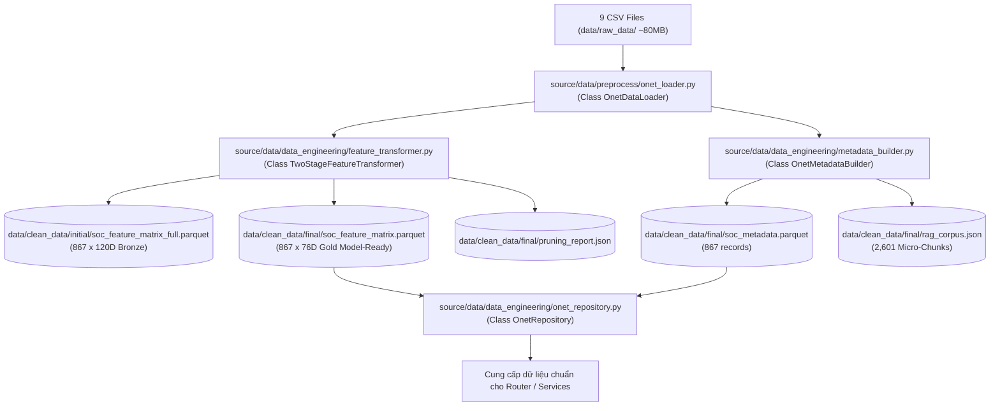

# Module 2: Data Pipeline & O*NET Feature Store (Kỹ Thuật Xử Lý Dữ Liệu)
## Trạng Thái: [x] ĐÃ HOÀN THÀNH 100% (Passed 7/7 Unit Tests)

---

## 1. Mục Tiêu Module
Giải quyết triệt để vấn đề phân tách trách nhiệm theo **Clean Architecture**:
* **Tách rời hoàn toàn khỏi tầng Service Runtime**: Toàn bộ nghiệp vụ tải, làm sạch, loại bỏ cột thừa của 9 file CSV O\*NET và xây dựng ma trận đặc trưng nằm trọn vẹn trong `source/data/`.
* **Phân định rõ Offline Batch Job**: Kích hoạt ngoại tuyến duy nhất qua CLI `source/services/cli/data_pipeline_cli.py`.
* **Phân chia 2 tầng lưu trữ sạch trong `data/clean_data/`**:
  1. `data/clean_data/initial/`: Chứa **`soc_feature_matrix_full.parquet`** (867 dòng $\times$ 120 cột Bronze Store).
  2. `data/clean_data/final/`: Chứa các tài sản dữ liệu model-ready:
     - **`soc_feature_matrix.parquet`** (867 dòng $\times$ 76 cột Gold Store sau Group-wise Pruning $|r| \ge 0.85$).
     - **`pruning_report.json`** (Báo cáo kiểm toán giải trình giảm chiều).
     - **`soc_metadata.parquet`** (867 records tra cứu < 1ms, bù khuyết lương 100%, từ điển 8,753 công cụ).
     - **`rag_corpus.json`** (Kho 2,601 Micro-Chunks theo khía cạnh gắn nhãn `major_group`).
* Triển khai **`OnetRepository`** hiện thực hóa interface `IOnetRepository` từ Domain để cung cấp dịch vụ tra cứu in-memory chuẩn hóa cho toàn hệ thống (< 50ms cho đối sánh chức danh, < 1ms cho RiskProfile).

---

## 2. Kiến Trúc & Sơ Đồ Xử Lý Dữ Liệu



---

## 3. Danh Sách Task Đã Hoàn Thành

### Task 2.1: Data Loader & Audit Preprocessor (`source/data/preprocess/onet_loader.py`)
* **Trạng thái**: `[x] Đã hoàn thành`
* **Triển khai**: `OnetDataLoader(IDataLoader)`
  - Đọc 9 tệp CSV, loại bỏ cột thống kê điều tra thừa (`SURVEY_NOISE_COLUMNS`).
  - Gom nhóm Base SOC 6 chữ số: $E = \frac{IM \times LV}{35.0} \in [0.0, 1.0]$.
  - Quản lý các attributes trạng thái: `skills_df_`, `knowledge_df_`, `abilities_df_`, `software_df_`, `tasks_df_`, `salaries_df_`, `threat_df_`, `job_titles_df_`.

---

### Task 2.2: Two-Stage Feature Pipeline (`source/data/data_engineering/feature_transformer.py`)
* **Trạng thái**: `[x] Đã hoàn thành`
* **Triển khai**: `TwoStageFeatureTransformer(IFeatureTransformer)`
  - **Giai đoạn 1 (extract_120d)**: Assembles 120D Zero-Leakage feature space (10 skills, 33 knowledge, 52 abilities, 20 software taxonomy categories, 5 economic & complexity metrics). Lưu tại `data/clean_data/initial/soc_feature_matrix_full.parquet`.
  - **Giai đoạn 2 (prune_features)**: Group-wise Correlation Pruning ($|r| \ge 0.85$) và Cross-group Tie-break ($|r| \ge 0.95$). Giảm từ 120D xuống 76D sạch đa cộng tuyến. Lưu tại `data/clean_data/final/soc_feature_matrix.parquet` và `pruning_report.json`.

---

### Task 2.3: Metadata Catalog & Aspect RAG Corpus (`source/data/data_engineering/metadata_builder.py`)
* **Trạng thái**: `[x] Đã hoàn thành`
* **Triển khai**: `OnetMetadataBuilder(IMetadataBuilder)`
  - Tính mức lương trung vị toàn quốc năm 2025 từ metro pay (360 mã SOC) và tự động bù khuyết lương cho 507 mã SOC còn lại.
  - Gán điểm rủi ro định chuẩn cho các mã SOC chưa khớp thuộc nhóm nông nghiệp (45-xxxx) và quân sự (55-xxxx).
  - Đóng gói toàn bộ 8,753 công cụ vào `software_skills_catalog`.
  - Sinh đúng 2,601 micro-chunks ($867 \times 3$ khía cạnh: `threat_mechanism`, `defense_skills`, `tasks_and_tools`) gắn nhãn `major_group`. Lưu tại `data/clean_data/final/soc_metadata.parquet` và `data/clean_data/final/rag_corpus.json`.

---

### Task 2.4: O*NET Repository Implementation (`source/data/data_engineering/onet_repository.py`)
* **Trạng thái**: `[x] Đã hoàn thành`
* **Triển khai**: `OnetRepository(IOnetRepository)`
  - `match_job_title(raw_title: str)`: Dùng RapidFuzz đối sánh nhanh chuỗi chức danh người dùng với 54k chức danh thị trường (< 50ms).
  - `get_risk_profile(soc_code: str)`: Trả về thực thể Domain `RiskProfile` (< 1ms).
  - `get_feature_vector(soc_code: str)`: Trả về vector 76D float32 cho mô hình ML (< 1ms).

---

### Task 2.5: CLI Orchestrator & Kiểm Thử Toàn Trình
* **Trạng thái**: `[x] Đã hoàn thành`
* **CLI Controller**: `source/services/cli/data_pipeline_cli.py`
  ```powershell
  python -m source.services.cli.data_pipeline_cli --corr-threshold 0.85
  ```
* **Bộ Test Tự Động**: `tests/test_data_pipeline.py`
  ```powershell
  python -m pytest tests/test_data_pipeline.py -v
  # Kết quả: 7 passed in 1.44s
  ```
