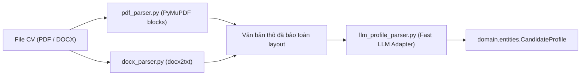

# Module 3: Document Ingestion Adapters (Bóc Tách CV)

---

## 1. Mục Tiêu Module
Triển khai tầng **Adapter Ingestion**:
* **Không chứa Schema**: Module này **import** `CandidateProfile` từ `source/domain/entities/candidate.py`.
* Chịu trách nhiệm kỹ thuật thuần túy: Đọc byte file PDF/DOCX, trích xuất text block không bị đảo dòng 2 cột, và dùng Fast LLM để điền dữ liệu vào entity `CandidateProfile`.

---

## 2. Kiến Trúc Adapter



---

## 3. Danh Sách Task Cần Code

### Task 3.1: PDF & DOCX Text Extractors (`source/parsers/document_parser.py`)
* **File cần code**: `source/parsers/document_parser.py`
* **Triển khai Interface**: `IDocumentParser` từ `domain/interfaces/parser.py`.
* **Kỹ thuật trích xuất**:
  - Dùng `fitz.open(file_path)`. Duyệt qua từng page và gọi `page.get_text("blocks")`. Sắp xếp các khối văn bản theo tọa độ đọc để không bị nhảy cột trên CV 2 cột.
  - Hỗ trợ DOCX qua `docx2txt.process(file_path)`.
* **Hàm cần viết**:
  - `class DocumentParser(IDocumentParser)`:
    - `extract_text(self, file_path: Path) -> str`

---

### Task 3.2: Fast LLM Profile Parser (`source/parsers/llm_profile_parser.py`)
* **File cần code**: `source/parsers/llm_profile_parser.py`
* **Triển khai Interface**: `IProfileExtractor` từ `domain/interfaces/parser.py`.
* **Kỹ thuật thực hiện**:
  - Sử dụng Fast LLM (`gemini-1.5-flash` hoặc `gpt-4o-mini`) với nhiệt độ `temperature=0.0`.
  - Sử dụng `llm.with_structured_output(CandidateProfile)` để đảm bảo 100% tuân thủ kiểu dữ liệu của Domain.
* **Hàm cần viết**:
  - `class LLMProfileParser(IProfileExtractor)`:
    - `extract_profile(self, raw_text: str) -> CandidateProfile`

---

### Task 3.3: Unit Test cho Parser Adapter (`tests/test_parsers.py`)
* **File cần code**: `tests/test_parsers.py`
* **Lệnh chạy test**:
  ```powershell
  pytest tests/test_parsers.py -v
  ```
