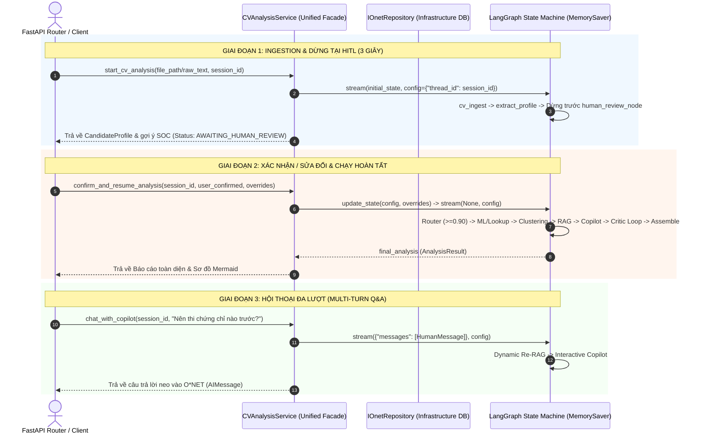

# Module 7: Application Services / Use Cases (Tầng Điều Phối Nghiệp Vụ) - [COMPLETED]

---

## 1. Mục Tiêu Module & Triết Lý Thiết Kế
Định nghĩa chuẩn xác vai trò của tầng **`source/services/`** trong Clean Architecture:
* **Service chỉ đóng vai trò là Nhạc Trưởng (Use Case Facade & Orchestrator)**:
  - **KHÔNG** đọc hay làm sạch 9 file CSV (đó là việc của `data_pipeline`).
  - **KHÔNG** tính toán toán học phân cụm hay chạy cây quyết định XGBoost (đó là việc của `model/ML_model`).
  - **KHÔNG** cào text từ PDF (đó là việc của `parsers`).
* **Tránh chống-mẫu "Fat Controller"**:
  - FastAPI Controller **CHỈ ĐƯỢC PHÉP INJECT VÀ GỌI DUY NHẤT** Use Case Facade: `CVAnalysisService`.
  - Toàn bộ quy trình từ Ingestion, HITL pause/resume, ML risk/clustering, Hybrid RAG, LangGraph Copilot roadmap và multi-turn chat đều được đóng gói 100% trong `CVAnalysisService`.
* **Tuân thủ chuẩn mực DDD (Domain-Driven Design)**:
  - Phân rã thư mục theo **Actor / Bounded Context**: `source/services/user/`, `source/services/cli/`, `source/services/system/`.
  - Toàn bộ Routing Strategies (`HybridRiskRouter`) và Sub-services (`UserCVService`, `UserCareerService`) của User nằm trọn vẹn trong `source/services/user/` để bảo đảm **High Cohesion**.

---

## 2. Kiến Trúc Điều Phối Của Use Case (Unified Facade)

---

## 3. Danh Sách Task Đã Hoàn Thành

### Task 7.1: Bộ Điều Phối Hybrid Risk Router (`source/services/user/risk_router.py`)
* **File**: `source/services/user/risk_router.py`
* **Vị trí**: Nằm trong `source/services/user/` theo chuẩn DDD Bounded Context.
* **Quy tắc định tuyến**:
  - Nếu `(confidence >= 0.90 or user_confirmed) and soc_code`: Tra cứu 0ms từ `IOnetRepository.get_risk_profile(soc_code)`.
  - Ngược lại (vai trò lai tạp, confidence < 0.90): Gọi `IRiskPredictor.predict_risk(profile)` (XGBoost Regressor + SHAP).

---

### Task 7.2: Use Case Facade Phân Tích CV Toàn Diện (`source/services/user/cv_analysis_service.py`)
* **File**: `source/services/user/cv_analysis_service.py`
* **Vai trò**: Master Orchestrator tích hợp LangGraph Copilot State Machine & MemorySaver checkpointing.
* **Các phương thức chính**:
  1. `start_cv_analysis(file_path=None, raw_cv_text=None, session_id=None) -> Dict[str, Any]` (chạy đến HITL pause).
  2. `confirm_and_resume_analysis(session_id, user_confirmed=True, overrides=None) -> AnalysisResult` (tiếp tục chạy đồ thị đến khi ra kết quả).
  3. `chat_with_copilot(session_id, message) -> str` (hội thoại đa lượt Re-RAG).
  4. `get_analysis_result(session_id) -> Optional[AnalysisResult]` (truy xuất nhanh kết quả phân tích theo session).
  5. `get_cv_analysis_service() -> CVAnalysisService` (FastAPI Dependency Injection Provider).

---

### Task 7.3: Hợp Nhất HITL Vào `CVAnalysisService`
* **Quyết định kiến trúc**: HITL bản chất là state transition (pause & resume) của một phiên phân tích CV. Không tách file riêng `hitl_service.py` để tránh phân mảnh và circular dependency. Được triển khai trực tiếp qua `confirm_and_resume_analysis` trong `CVAnalysisService`.

---

### Task 7.4: Unit Tests Toàn Diện Cho Module 7 (`tests/test_services.py`)
* **File**: `tests/test_services.py`
* **Phương pháp**: Mock 100% offline, zero-token, zero network calls.
* **Kết quả kiểm thử**: 10/10 test cases passed (18.81s).
  - `test_hybrid_risk_router_high_confidence`
  - `test_hybrid_risk_router_low_confidence`
  - `test_hybrid_risk_router_user_confirmed_override`
  - `test_hybrid_risk_router_fallback_on_missing_soc`
  - `test_cv_analysis_service_start_to_hitl`
  - `test_cv_analysis_service_confirm_and_resume`
  - `test_cv_analysis_service_chat_with_copilot`
  - `test_cv_analysis_service_get_analysis_result`
  - `test_cv_analysis_service_error_handling`
  - `test_get_cv_analysis_service_factory`

