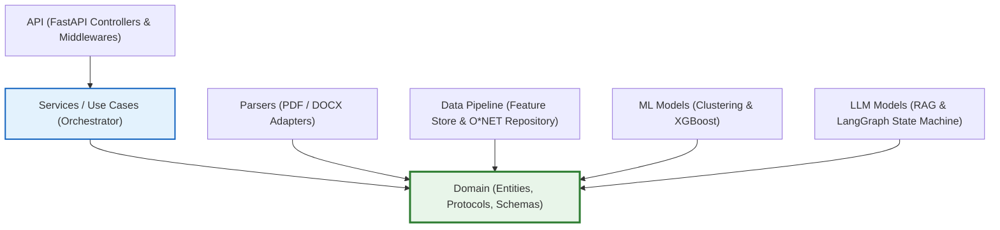

# Lộ Trình Triển Khai Code Tay (Clean Architecture / DDD)
## AI Recruiter & Career Copilot

Bản đồ chỉ đường tổng thể theo tiêu chuẩn **Clean Architecture** (Robert C. Martin) và **Domain-Driven Design (DDD)**. Hệ thống phân chia ranh giới rõ ràng:
* **Tầng Domain (`source/domain/`)**: Lõi nghiệp vụ độc lập, chứa toàn bộ thực thể (Entities) và giao diện chuẩn (Interfaces/Protocols).
* **Tầng Data Pipeline (`source/data_pipeline/`)**: Chuyên trách đọc, làm sạch 9 CSV và xây dựng Feature Store Parquet (không để trong Service). Xem cẩm nang dữ liệu tại [`docs/data_tutorial/`](file:///c:/Users/Hai%20Nam/full_project/Job_advisor/docs/data_tutorial).
* **Tầng Adapters (`parsers/`, `model/`)**: Triển khai các interface từ Domain (đọc file PDF, chạy ML/LLM).
* **Tầng Use Cases / Services (`source/services/`)**: **Nhạc trưởng (Orchestrator)** chỉ gọi và điều phối các hàm chức năng, không chứa logic xử lý dữ liệu thô.
* **Tầng Presentation (`source/api/`)**: Giao diện REST API FastAPI kết nối với client.

---

## 1. Sơ Đồ Phụ Thuộc Hướng Tâm (Dependency Rule)

---

## 2. Bảng Checklist Tổng Thể Các Module

| Phase | Module | Thư mục mã nguồn | File hướng dẫn chi tiết | Trạng thái |
| :---: | :--- | :--- | :--- | :---: |
| **0** | **Môi trường & Cấu hình** | `source/infrastructure/` | [`00_setup_environment.md`](file:///c:/Users/Hai%20Nam/full_project/Job_advisor/docs/tasks/00_setup_environment.md) | `[x] Hoàn thành 100% (Settings, Logging, Config)` |
| **1** | **Domain Entities & Protocols** | `source/domain/` | [`01_domain_module.md`](file:///c:/Users/Hai%20Nam/full_project/Job_advisor/docs/tasks/01_domain_module.md) | `[x] Hoàn thành 100% (Entities, Protocols, Exceptions)` |
| **2** | **Data Pipeline & Feature Store** | `source/data/` | [`02_data_pipeline_module.md`](file:///c:/Users/Hai%20Nam/full_project/Job_advisor/docs/tasks/02_data_pipeline_module.md) | `[x] Hoàn thành 100% (initial & final store)` |
| **3** | **Document Parsers (Adapters)** | `source/parsers/` | [`03_parsers_module.md`](file:///c:/Users/Hai%20Nam/full_project/Job_advisor/docs/tasks/03_parsers_module.md) | `[x] Hoàn thành 100% (DocumentParser, LLMProfileParser DeepSeek, Tests)` |
| **4** | **Lõi Học Máy (ML Core)** | `source/model/ML_model/` | [`04_ml_core_module.md`](file:///c:/Users/Hai%20Nam/full_project/Job_advisor/docs/tasks/04_ml_core_module.md) | `[ ] Chưa bắt đầu` |
| **5** | **Hierarchical Aspect RAG** | `source/model/LLM_model/rag/` | [`05_rag_engine_module.md`](file:///c:/Users/Hai%20Nam/full_project/Job_advisor/docs/tasks/05_rag_engine_module.md) | `[ ] Chưa bắt đầu` |
| **6** | **LangGraph Copilot Agent** | `source/model/LLM_model/` | [`06_langgraph_copilot_module.md`](file:///c:/Users/Hai%20Nam/full_project/Job_advisor/docs/tasks/06_langgraph_copilot_module.md) | `[ ] Chưa bắt đầu` |
| **7** | **Use Case Services (Orchestrator)** | `source/services/` | [`07_services_use_cases.md`](file:///c:/Users/Hai%20Nam/full_project/Job_advisor/docs/tasks/07_services_use_cases.md) | `[ ] Chưa bắt đầu` |
| **8** | **FastAPI Presentation Layer** | `source/api/` | [`08_api_backend_module.md`](file:///c:/Users/Hai%20Nam/full_project/Job_advisor/docs/tasks/08_api_backend_module.md) | `[ ] Chưa bắt đầu` |
